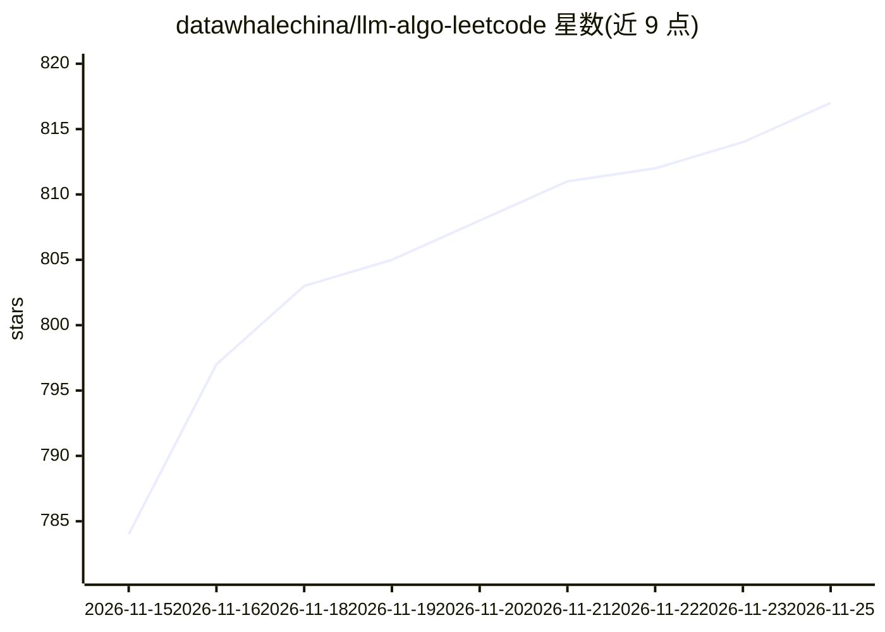

# datawhalechina/llm-algo-leetcode

⭐ 817 · Jupyter Notebook · NOASSERTION · 推送 2026-11-21 · [GitHub](https://github.com/datawhalechina/llm-algo-leetcode) · [官网](https://datawhalechina.github.io/llm-algo-leetcode/) · 组织维护 · 中文 README

**以 Notebook 为载体的大模型算法与系统教程**

Datawhale 维护的可运行 Notebook 教程，覆盖模型架构与训练、后训练优化、推理优化、性能优化与算子优化五条主线，按 PyTorch → Triton → CUDA 路径从模型实现下探到 GPU kernel 与系统调优。每节含题目区、答案区与基础验证，并通过 benchmark、profiling 与真实 GPU/inference backend 实验对比吞吐、延迟与显存。Part 00-03 已完成，Part 04-05 建设中；本地 CPU 练习提供 git clone 与环境配置脚本入口。

## 筛选速览

| 维度 | 判定 | 备注 |
|---|---|---|
| AI 角色 | `ai-knowledge` | 知识聚合/清单类 |
| 许可风险 | `none` | NOASSERTION |
| 部署形态 | `None` |  |
| 模型依赖 | — | README 未给出锁定关系 |
| 硬件要求 | — | 无带数字的原话,不猜 |
| 安装摩擦 | `medium` | 含编译或系统依赖之一 |
| 成熟度 | — | 结构信号不足 |

## 能力要点

- 五条主学习路线加基础、横向、领域专题导航
- Notebook-first：可运行代码、题目区、答案区与基础验证
- 从 PyTorch 到 Triton、CUDA 的算子与系统优化贯通
- 配套 Colab 徽章与 VitePress 文档站点

## 适用场景

- 用 PyTorch Notebook 系统学习 Transformer 训练、微调与推理
- 学习 Triton/CUDA 算子开发与 GPU 性能优化
- 通过 benchmark 与 profiling 实验建立推理部署的工程判断

## 场景标签

`教程课程` · 领域:学习与行业

## 证据(README 行号)

> L3:  Runnable notebooks for LLM algorithms and systems.
> L27: 这是一个以 Notebook 为载体的大模型算法与系统教程。教程从 Part 02 的 PyTorch 算法实践出发，按需回补 Part 00 / Part 01 的基础，并进一步延伸到 Part 03 的 Triton 算子开发
> L33: 1. **Notebook-first**：每节围绕可运行代码、题目区、答案区和基础验证展开，适合边学边改。

## 星数曲线

2026-11-15 784 → 2026-11-25 817（+33）

---
*卡片 v1 · prompt 1.4 · 生成 2026-11-24 · 置信度 high · 依据 README sha `50d1c69ffe23` · [字段定义](../../DATASET.md)*
