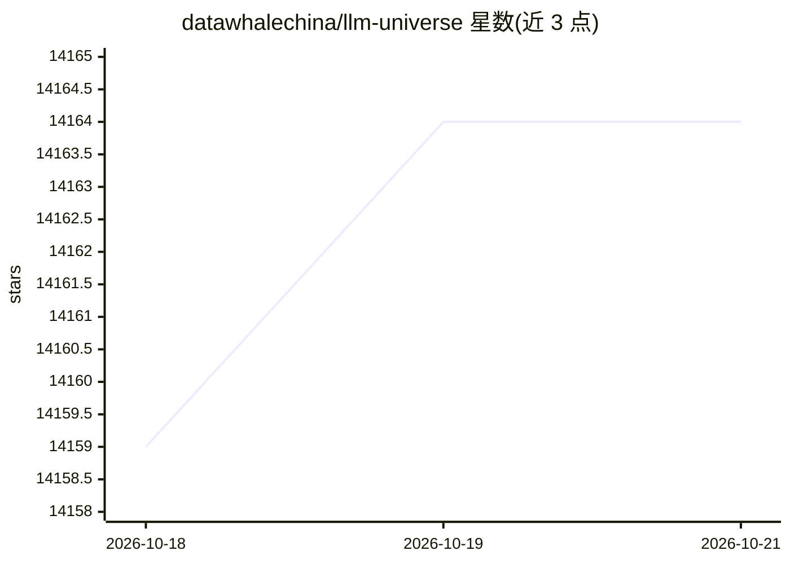

# datawhalechina/llm-universe

⭐ 14,164 · Jupyter Notebook · 推送 2026-08-27 · [GitHub](https://github.com/datawhalechina/llm-universe) · [官网](https://datawhalechina.github.io/llm-universe/) · 组织维护 · 中文 README

**面向小白的中文大模型应用开发教程：RAG 知识库助手**

Datawhale 出品的中文开源教程，以个人知识库助手项目为主线，讲解大模型应用开发流程：调用大模型 API、搭建向量知识库、用 LangChain 构建检索问答链、Streamlit 部署、评估与优化，并规划进阶 RAG 技巧与开源应用解读两部分内容。面向具备基础 Python 能力、无人工智能与算法基础的开发者。对百度文心、讯飞星火、智谱 GLM 等 API 做了统一封装。教程不需要 GPU，提供阿里云服务器学生免费领取及本地环境搭建指南。

## 筛选速览

| 维度 | 判定 | 备注 |
|---|---|---|
| AI 角色 | `ai-knowledge` | 知识聚合/清单类 |
| 许可风险 | `none` | — |
| 部署形态 | `None` |  |
| 模型依赖 | — | README 未给出锁定关系 |
| 硬件要求 | — | 无带数字的原话,不猜 |
| 安装摩擦 | `low` | 无编译、无系统依赖或容器化 |
| 成熟度 | — | 结构信号不足 |

## 动量与使用信号

- 维护:`active` — 距上次 push 52.2 天,年发版 0,23 位贡献者
- 涨星:近 1 天 **+9**(自 20261016 起算)
- 下载:GitHub Release 附件 累计 16,846(1 个 release)

## 能力要点

- 基于个人知识库助手项目的实践式课程，含 API 调用、向量库、RAG 问答链、部署与评估全流程
- 对 GPT、百度文心、讯飞星火、智谱 GLM 等国内外主要 LLM API 统一封装，支持一键调用
- 无需 GPU 环境，提供阿里云服务器学生免费领取与本地环境搭建指南
- 内容大纲含进阶 RAG 技巧（分块优化、混合检索、微调向量模型等）与开源应用案例解读

## 适用场景

- 零基础入门大模型应用开发，搭一个 RAG 知识库问答 Demo
- 学习统一封装国内外多家大模型 API 的调用方式
- 了解进阶 RAG 的检索优化与评估方法

## 场景标签

`教程课程` `RAG` · 领域:知识与检索

## 证据(README 行号)

> L13: 本项目是一个面向小白开发者的大模型应用开发教程，旨在基于阿里云服务器，结合个人知识库助手项目，通过一个课程完成大模型开发的重点入门，主要内容包括：
> L47: 所有具备基础 Python 能力，想要掌握 LLM 应用开发技能的开发者。
> L63: 3. 兼具统一性与拓展性。本项目对 GPT、百度文心、讯飞星火、智谱GLM 等国内外主要 LLM API 进行了统一封装，支持一键调用不同的 LLM，帮助开发者将更多的精力放在学习应用与模型本身的优化上，而不需要花时间在繁琐的调用

## 星数曲线

2026-10-18 14,159 → 2026-10-21 14,164（+5）

---
*卡片 v1 · prompt 1.4 · 生成 2026-10-18 · 置信度 high · 依据 README sha `6c887dcee88b` · [字段定义](../../DATASET.md)*
