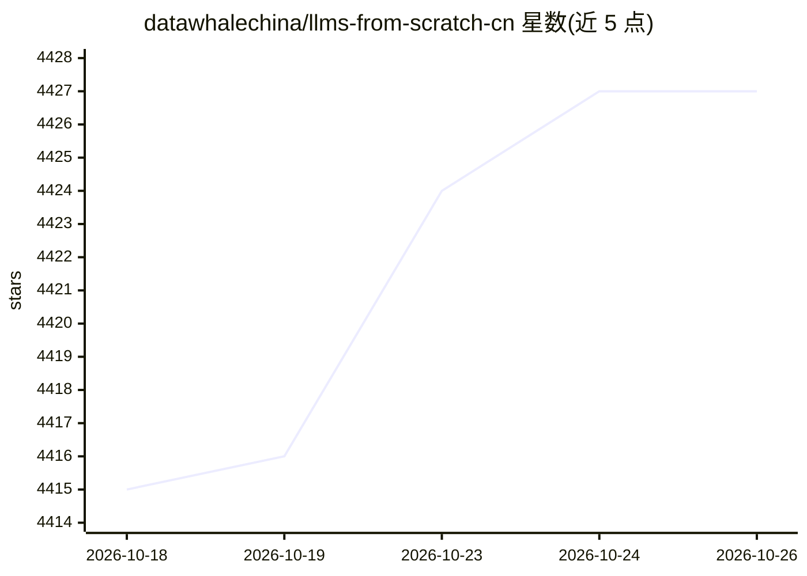

# datawhalechina/llms-from-scratch-cn

⭐ 4,427 · Jupyter Notebook · NOASSERTION · 推送 2026-09-17 · [GitHub](https://github.com/datawhalechina/llms-from-scratch-cn) · 组织维护 · 中文 README

**从0构建大语言模型的中文实践教程（GLM4/Llama3/RWKV6）**

Datawhale 维护的 LLM 构建教程项目：基础知识部分基于 rasbt/LLMs-from-scratch 提供从文本处理、注意力机制、GPT 实现到预训练的 notebook 教程（第6-8章标注即将发布）；模型架构部分收录 ChatGLM3/4、Llama3、RWKV V2-V6、MiniCPM 等架构解析 notebook，含配置与训练脚本。面向有 Python/PyTorch 基础、希望深入理解 LLM 原理的开发者与研究者。采用 CC BY-NC-SA 4.0 许可。

## 筛选速览

| 维度 | 判定 | 备注 |
|---|---|---|
| AI 角色 | `ai-knowledge` | 知识聚合/清单类 |
| 许可风险 | `none` | NOASSERTION |
| 部署形态 | `None` |  |
| 模型依赖 | — | README 未给出锁定关系 |
| 硬件要求 | — | 无带数字的原话,不猜 |
| 安装摩擦 | `low` | 无编译、无系统依赖或容器化 |
| 成熟度 | — | 结构信号不足 |

## 能力要点

- 分章节 notebook 覆盖编码、注意力、GPT 实现、预训练全过程
- 涵盖 ChatGLM3/4、Llama3、RWKV V2-V6、MiniCPM 架构解析
- 基于 rasbt/LLMs-from-scratch 的中文化教程与译书路径
- 由多所高校学生组成贡献者团队

## 适用场景

- 通过手写代码理解 GPT 类模型内部机制
- 对比学习 GLM、Llama、RWKV 等模型架构差异
- 系统入门 LLM 预训练与微调的代码实现

## 场景标签

`教程课程` `模型训练` · 领域:学习与行业

## 证据(README 行号)

> L14: 本项目 "LLMs From Scratch" 是由 Datawhale 提供的一个从头开始构建类似 ChatGPT 大型语言模型（LLM）的实践教程。
> L16: 本项目包括了从0逐步构建GLM4\Llama3\RWKV6的教程，从0构建大模型，一起深入理解大模型原理。

## 星数曲线

2026-10-18 4,415 → 2026-10-26 4,427（+12）

---
*卡片 v1 · prompt 1.4 · 生成 2026-10-20 · 置信度 high · 依据 README sha `411112045ad1` · [字段定义](../../DATASET.md)*
