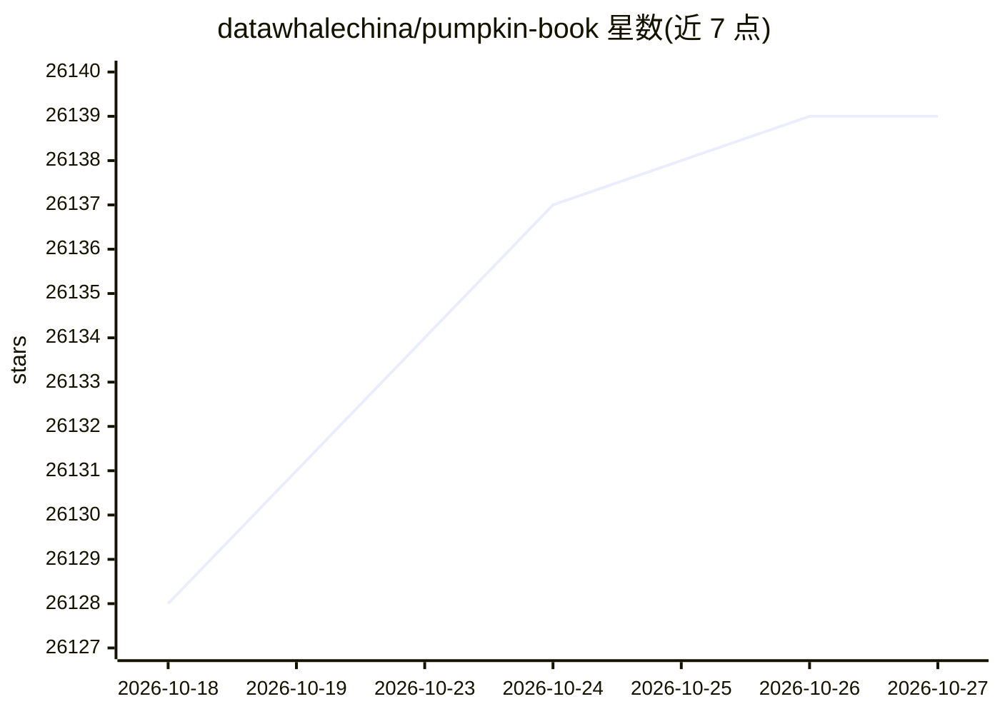

# datawhalechina/pumpkin-book

⭐ 26,139 · NOASSERTION · 推送 2026-04-22 · [GitHub](https://github.com/datawhalechina/pumpkin-book) · 组织维护 · 中文 README

**机器学习学习者的西瓜书公式推导详解笔记**

对周志华《机器学习》（西瓜书）中较难理解的公式进行解析，并补充部分公式的推导细节，内容以本科数学基础视角表述，超纲知识以附录和参考文献给出。使用前提是读者具备西瓜书内容作为前置知识，定位为西瓜书的配套查阅资料而非独立教材。提供在线阅读、PDF 下载、B 站视频教程及组队学习资源，另有经人民邮电出版社修缮的纸质版。

## 筛选速览

| 维度 | 判定 | 备注 |
|---|---|---|
| AI 角色 | `ai-knowledge` | 知识聚合/清单类 |
| 许可风险 | `none` | NOASSERTION |
| 部署形态 | `None` |  |
| 模型依赖 | — | README 未给出锁定关系 |
| 硬件要求 | — | 无带数字的原话,不猜 |
| 安装摩擦 | `low` | 无编译、无系统依赖或容器化 |
| 成熟度 | — | 结构信号不足 |

## 动量与使用信号

- 维护:`maintenance` — 距上次 push 178.5 天,年发版 0,24 位贡献者
- 涨星:近 1 天 **+5**(自 20261016 起算)
- 下载:GitHub Release 附件 累计 135,264(8 个 release)

## 能力要点

- 对西瓜书公式补充推导细节与解析
- 以本科数学基础视角讲解，超纲内容附附录与参考文献
- 提供 PDF 下载、视频教程与组队学习等配套资源

## 适用场景

- 自学西瓜书时查阅推导不出来的公式
- 机器学习初学者按组队学习计划配套学习
- 需要离线阅读时下载 PDF 版本

## 场景标签

`教程课程` · 领域:学习与行业

## 证据(README 行号)

> L1: 南瓜书（pumpkin-book）
> L3: “周志华老师的《机器学习》（西瓜书）是机器学习领域的经典入门教材之一，周老师为了使尽可能多的读者通过西瓜书对机器学习有所了解, 所以在书中对部分公式的推导细节没有详述，但是这对那些想深究公式推导细节的读者来说可能“不太友好”，本书旨
> L13: ## 配套资源

## 星数曲线

2026-10-18 26,128 → 2026-10-27 26,139（+11）

---
*卡片 v1 · prompt 1.4 · 生成 2026-10-18 · 置信度 high · 依据 README sha `56f1fbeab17f` · [字段定义](../../DATASET.md)*
