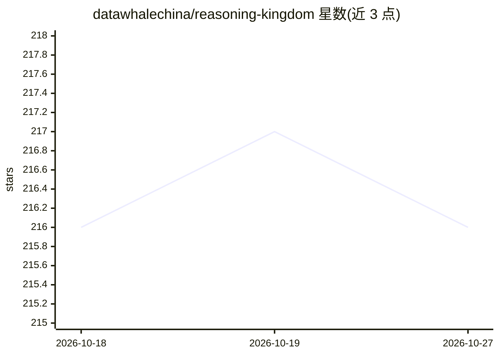

# datawhalechina/reasoning-kingdom

⭐ 216 · 推送 2026-08-27 · [GitHub](https://github.com/datawhalechina/reasoning-kingdom) · [官网](https://datawhalechina.github.io/reasoning-kingdom/) · 组织维护 · 中文 README

**三部曲开源书籍：从信息论与逻辑剖析 AI 推理的本质与边界**

由 Datawhale 维护的推理科学三部曲开源书籍：前传面向青少年从布尔逻辑讲到 Transformer；上卷沿历史线索从熵增、符号主义到因果推断与复杂度理论；下卷用形式系统重建推理，涵盖哥德尔不完备定理、线性逻辑、PAC 学习、范畴论，收束于八条边界与'不可能三角'。另附 163 个概念的小词典与面向高中生的兔狲学院六个学科词条。使用 VitePress 构建静态网站，在线阅读，CC BY-NC-SA 4.0 许可，禁止商业使用。

## 筛选速览

| 维度 | 判定 | 备注 |
|---|---|---|
| AI 角色 | `ai-knowledge` | 知识聚合/清单类 |
| 许可风险 | `none` | — |
| 部署形态 | `library` | 以包/库形式分发 |
| 模型依赖 | — | README 未给出锁定关系 |
| 硬件要求 | — | 无带数字的原话,不猜 |
| 安装摩擦 | `low` | 无编译、无系统依赖或容器化 |
| 成熟度 | — | 结构信号不足 |

## 能力要点

- 三部曲结构：入门18章 + 历史13章 + 形式化12章，均标注已完成
- 下卷从命题逻辑到范畴论形式化重建，提出推理'不可能三角'
- 兔狲教授小词典：163 个核心概念的'官方解释+兔狲说'对比
- 兔狲学院面向高中生的六个学科词条式教学

## 适用场景

- 系统学习推理科学：从布尔逻辑到哥德尔边界
- 理解 LLM 的'概率预测'与'逻辑推理'的区别
- 查阅 AI/计算/逻辑核心概念的对比释义

## 场景标签

`教程课程` · 领域:学习与行业

## 证据(README 行号)

> L11: **推理王国**是一个完整的三部曲开源书籍项目，从入门到深入，全面探索推理科学的本质：
> L17: 这不是 AI 工具书，也不是机器学习教程。它追问的是更底层的问题：推理是什么？它的边界在哪里？当 AI 在"推理"，它内部发生了什么？

## 星数曲线

2026-10-18 216 → 2026-10-27 216（+0）

---
*卡片 v1 · prompt 1.4 · 生成 2026-10-22 · 置信度 high · 依据 README sha `a8afb796ac4b` · [字段定义](../../DATASET.md)*
