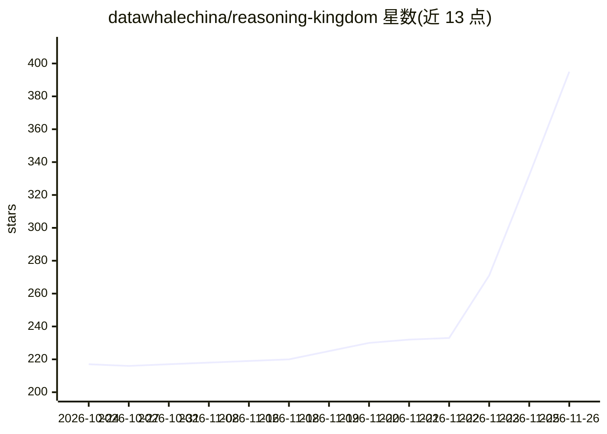

# datawhalechina/reasoning-kingdom

⭐ 395 · TypeScript · NOASSERTION · 推送 2026-11-23 · [GitHub](https://github.com/datawhalechina/reasoning-kingdom) · [官网](https://datawhalechina.github.io/reasoning-kingdom/) · 组织维护 · 中文 README

**面向青少年与爱好者的 AI 推理机制开源三部曲书籍**

Datawhale 出品的开源书籍项目，由前传、上卷、下卷三部曲组成：前传面向青少年与业余读者入门推理科学，上卷沿历史脉络梳理符号主义、表示学习、因果推断到 Transformer 与推理边界，下卷从形式系统出发重建推理结构并给出收敛判据。另附 152 个词条的名词词典。以 VitePress 构建静态站点提供在线阅读，本地需 npm 安装依赖后运行开发服务器。README 明确说明它不是 AI 工具书或机器学习教程，而是探讨推理本质的理论读物。

## 筛选速览

| 维度 | 判定 | 备注 |
|---|---|---|
| AI 角色 | `ai-knowledge` | 知识聚合/清单类 |
| 许可风险 | `none` | NOASSERTION |
| 部署形态 | `library` | 以包/库形式分发 |
| 模型依赖 | — | README 未给出锁定关系 |
| 硬件要求 | — | 无带数字的原话,不猜 |
| 安装摩擦 | `low` | 无编译、无系统依赖或容器化 |
| 成熟度 | — | 结构信号不足 |

## 能力要点

- 三部曲结构：入门前传 + 历史演变上卷 + 形式演绎下卷（共 42 章）
- 152 个核心概念的兔狲教授小词典，含官方解释与个人解读对照
- 章节状态标注（编写中/已完成/修订中）
- VitePress 构建的在线阅读站点

## 适用场景

- 系统学习从布尔逻辑到 Transformer 的推理科学脉络
- 青少年和业余读者入门算法思维与神经网络原理
- 查阅学术名词的通俗解释与延伸思考

## 场景标签

`教程课程` · 领域:学习与行业

## 证据(README 行号)

> L9: **推理王国**是一个完整的三部曲开源书籍项目，从入门到深入，全面探索推理科学的本质：
> L15: 这不是 AI 工具书，也不是机器学习教程。它追问的是更底层的问题：推理是什么？它的边界在哪里？当 AI 在"推理"，它内部发生了什么？

## 星数曲线

2026-10-24 217 → 2026-11-26 395（+178）

---
*卡片 v1 · prompt 1.4 · 生成 2026-11-25 · 置信度 high · 依据 README sha `8c74d4417b18` · [字段定义](../../DATASET.md)*
