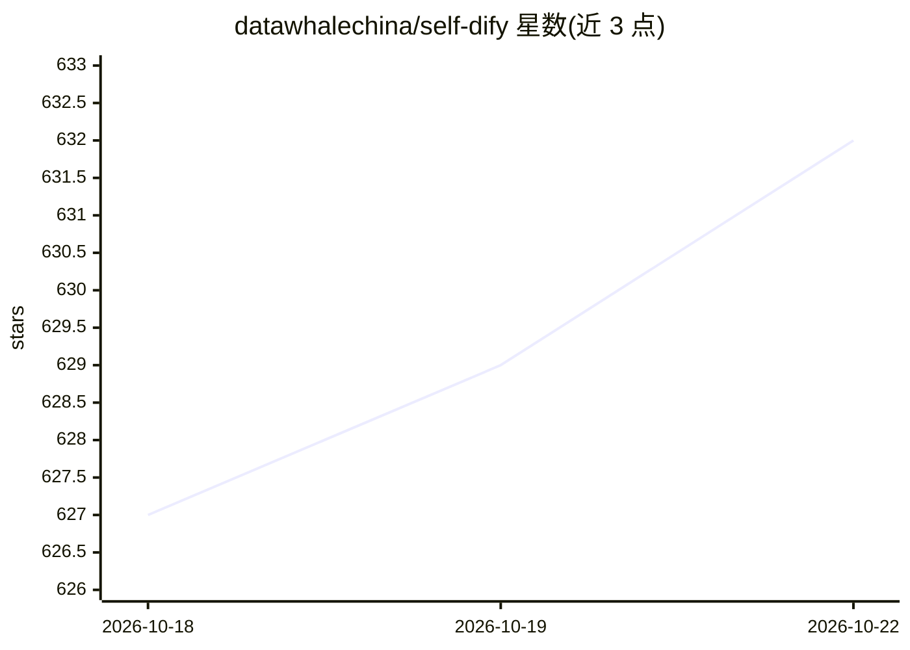

# datawhalechina/self-dify

⭐ 632 · CC-BY-SA-4.0 · 推送 2025-12-21 · [GitHub](https://github.com/datawhalechina/self-dify) · 组织维护 · 中文 README

**基于 Dify 的大模型应用开发中文教程（11 个实战项目）**

Datawhale 社区出品的《Dify 应用开发指南》教程仓库：从 Docker 安装与 Dify 本地部署讲起，通过“哄哄模拟器”“小红书读书卡片”“面试宝典”“text2sql 数据分析”等 11 个按难度分级（⭐-⭐⭐⭐⭐）的实战项目，覆盖提示词设计、Agent 工作流、知识库 RAG、DeepResearch、MCP 与多模态语音应用。面向 AI 开发者、产品经理、在校学生，无需深厚编程背景，需自备 LLM API Key 或本地 Ollama。另可通过 git checkout 访问 v1.0 旧版教程。

## 筛选速览

| 维度 | 判定 | 备注 |
|---|---|---|
| AI 角色 | `ai-knowledge` | 知识聚合/清单类 |
| 许可风险 | `viral` | CC-BY-SA-4.0 |
| 部署形态 | `self-host` | docker 或自建部署 |
| 模型依赖 | local-ok | 支持本地模型 |
| 硬件要求 | — | 无带数字的原话,不猜 |
| 安装摩擦 | `low` | 无编译、无系统依赖或容器化 |
| 成熟度 | — | 结构信号不足 |

## 能力要点

- 11 个按难度分级的 Dify 实战项目，覆盖环境配置到进阶任务
- 涵盖工作流编排、知识库 RAG、DeepResearch、MCP、多模态等主题
- 提供零基础新手与有经验开发者两条学习路线
- 可通过 git checkout v1.0.0 访问往期教程

## 适用场景

- 零基础入门 Dify 并搭建自己的 AI 应用环境
- 通过实战项目学习提示词、工作流与知识库开发
- 产品经理或学生了解大模型应用的构建方式

## 场景标签

`教程课程` · 领域:学习与行业

## 证据(README 行号)

> L3: 📚 《Dify 应用开发指南》——从零开始学习并掌握基于 Dify 的大模型应用开发
> L9: 本教程将全面指导你如何快速搭建自己的 AI 应用环境，从 Docker 的安装与配置开始，到本地部署 Dify 并自定义 AI 助手功能，让你轻松实现“猜病例”、“甜蜜哄人”、“新生入学指南”、“小红书读书卡片”与“面试宝典”等多种
> L36: |序号|教程名称|难度|类别|核心知识点|文档链接|

## 星数曲线

2026-10-18 627 → 2026-10-22 632（+5）

---
*卡片 v1 · prompt 1.4 · 生成 2026-10-21 · 置信度 mid · 依据 README sha `0a049c3e080b` · [字段定义](../../DATASET.md)*
