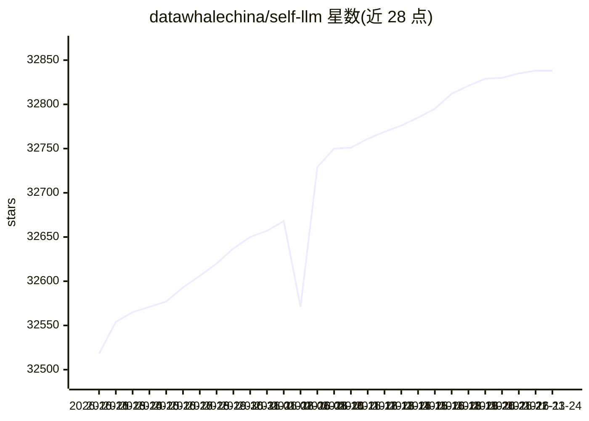

# datawhalechina/self-llm

⭐ 32,845 · Jupyter Notebook · Apache-2.0 · 推送 2026-11-17 · [GitHub](https://github.com/datawhalechina/self-llm) · 组织维护 · 中文 README

**面向国内初学者的 Linux 开源大模型部署微调教程**

以教程为主体内容的开源项目，围绕开源 LLM/MLLM 提供环境配置、本地部署（命令行调用、在线 Demo、框架集成）、全量微调与高效微调（LoRA、ptuning）的全流程指导。覆盖 50+ 主流模型，并设有 AMD ROCm、昇腾 Ascend NPU、摩尔线程 MUSA、Apple M 等多硬件平台专区，各平台提供对应环境配置、部署与性能测试教程。目标读者为无法便利使用 API、希望低成本本地使用或私域微调开源大模型的学生与研究者。

## 筛选速览

| 维度 | 判定 | 备注 |
|---|---|---|
| AI 角色 | `ai-knowledge` | 知识聚合/清单类 |
| 许可风险 | `permissive` | Apache-2.0 |
| 部署形态 | `None` |  |
| 模型依赖 | — | README 未给出锁定关系 |
| 硬件要求 | — | 无带数字的原话,不猜 |
| 安装摩擦 | `low` | 无编译、无系统依赖或容器化 |
| 成熟度 | — | 结构信号不足 |

## 动量与使用信号

- 维护:`active` — 距上次 push 36.2 天,年发版 0,83 位贡献者
- 涨星:近 1 天 **+16**(自 20261016 起算)
- 安装:github 包 `release-assets` 月下载无数据
- 平台:LINUX · 协议:OLLAMA

## 能力要点

- 覆盖 50+ 主流开源 LLM/MLLM 的部署、微调与使用教程
- 提供全量微调、LoRA、ptuning 等微调方法教程
- 设有 AMD ROCm、昇腾 Ascend NPU、摩尔线程 MUSA 等国产/多硬件平台专区
- 提供 Chat-嬛嬛、天机、AMChat 等微调示例项目

## 适用场景

- 在 Linux 环境下从零学习开源大模型的环境配置与本地部署
- 想低成本长期使用开源 LLM，替代付费 API
- 基于开源模型做领域私域模型的 LoRA 微调
- 在昇腾/摩尔线程等国产硬件上部署开源模型

## 场景标签

`教程课程` `微调` · 领域:学习与行业

## 证据(README 行号)

> L5: &emsp;&emsp;本项目是一个围绕开源大模型、针对国内初学者、基于 Linux 平台的中国宝宝专属大模型教程，针对各类开源大模型提供包括环境配置、本地部署、高效微调等技能在内的全流程指导，简化开源大模型的部署、使用和应用流程，
> L9:  1. 基于 Linux 平台的开源 LLM 环境配置指南，针对不同模型要求提供不同的详细环境配置步骤；
> L12:  4. 开源 LLM 的全量微调、高效微调方法，包括分布式全量微调、LoRA、ptuning 等。
> L69:  ✨ 已支持 50+ 主流大语言模型 ✨

## 星数曲线

2026-10-21 32,518 → 2026-11-24 32,838（+320）

---
*卡片 v1 · prompt 1.4 · 生成 2026-11-22 · 置信度 high · 依据 README sha `8d8e2b803090` · [字段定义](../../DATASET.md)*
