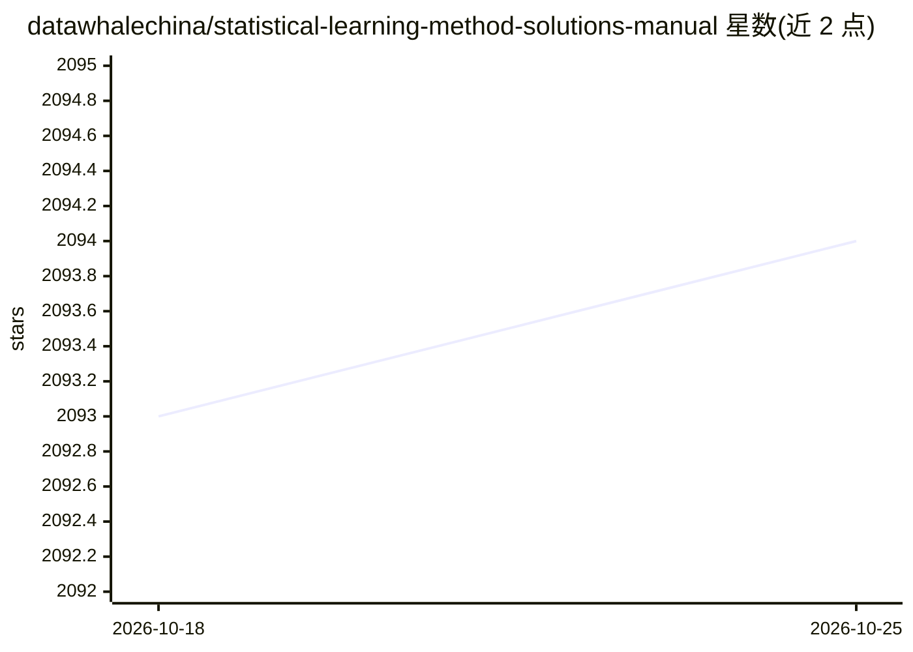

# datawhalechina/statistical-learning-method-solutions-manual

⭐ 2,095 · Jupyter Notebook · NOASSERTION · 推送 2026-05-08 · [GitHub](https://github.com/datawhalechina/statistical-learning-method-solutions-manual) · [官网](https://datawhalechina.github.io/statistical-learning-method-solutions-manual) · 组织维护 · 中文 README

**李航《机器学习方法》全书习题解答与 Python 实现教程**

Datawhale 组织维护的习题解答开源教程：针对李航《机器学习方法》（清华大学出版社 2022 版），覆盖监督学习、无监督学习、深度学习三大部分的课后习题详解，配 Jupyter Notebook 编写并导出 markdown，经 VitePress 生成在线阅读站点。每章提供 Python 代码实现（感知机、SVM、EM、LDA、CNN/LSTM/Seq2Seq 等，部分基于 PyTorch），并附运行结果截图与决策树可视化。README 标注为 Alpha 内测版，尚不完整且可能存在错误；第 26 章仍在进行中。

## 筛选速览

| 维度 | 判定 | 备注 |
|---|---|---|
| AI 角色 | `ai-knowledge` | 知识聚合/清单类 |
| 许可风险 | `none` | NOASSERTION |
| 部署形态 | `library` | 以包/库形式分发 |
| 模型依赖 | — | README 未给出锁定关系 |
| 硬件要求 | — | 无带数字的原话,不猜 |
| 安装摩擦 | `medium` | 含编译或系统依赖之一 |
| 成熟度 | `idea` | |

## 能力要点

- 覆盖约 27 章习题的详细解答与配套 Python 代码
- 监督/无监督/深度学习三大部分，含自编程实现与 sklearn 调用两种版本
- Jupyter Notebook 编写，VitePress 构建在线阅读站点
- 针对书中难点提供勘误与补充说明

## 适用场景

- 学习李航《机器学习方法》时对照习题解答理解推导
- 查看感知机、SVM、EM、LDA 等算法的 Python 实现代码
- 考研或求职前系统复习机器学习基础理论

## 场景标签

`教程课程` · 领域:学习与行业

## 证据(README 行号)

> L6: &emsp;&emsp;李航老师的《统计学习方法》和《机器学习方法》是机器学习领域的经典入门教材之一。本书分为监督学习、无监督学习和深度学习，全面系统地介绍了机器学习的主要方法。
> L20: - **全书习题详解**：涵盖监督学习、无监督学习、深度学习三大部分的课后习题详细解答。
> L21: - **Python 代码实现**：提供相关算法的 Python 代码实现（基于 Python 3.10+，部分涉及 PyTorch），帮助你从理论走向实践。

## 星数曲线

2026-10-18 2,093 → 2026-10-25 2,094（+1）

---
*卡片 v1 · prompt 1.4 · 生成 2026-10-21 · 置信度 mid · 依据 README sha `be7c97a5f62d` · [字段定义](../../DATASET.md)*
