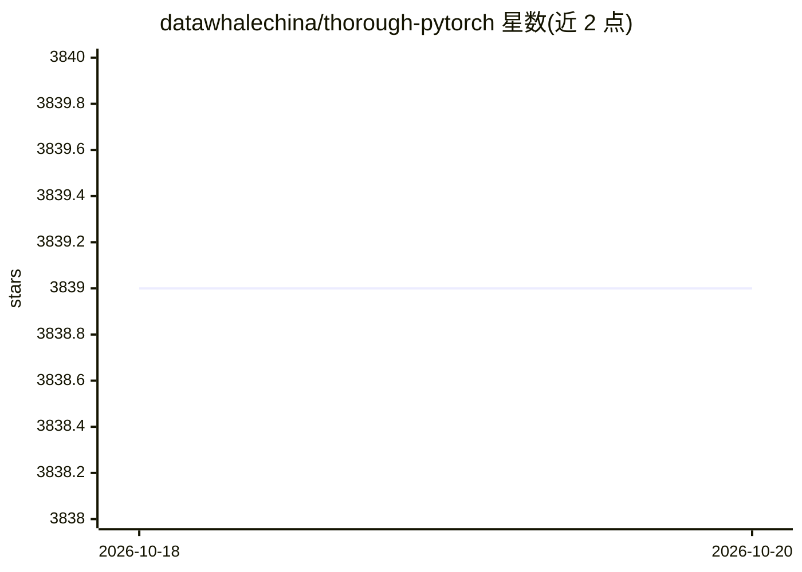

# datawhalechina/thorough-pytorch

⭐ 3,839 · Jupyter Notebook · NOASSERTION · 推送 2026-01-18 · [GitHub](https://github.com/datawhalechina/thorough-pytorch) · [官网](https://datawhalechina.github.io/thorough-pytorch/) · 组织维护 · 中文 README

**Datawhale 出品的 PyTorch 中文入门教程（组队学习课程）**

《深入浅出PyTorch》是 Datawhale 组织的系列开源教程，以 markdown 与 jupyter notebook 形式存于仓库，配套在线文档与 B 站直播回放。内容覆盖 PyTorch 安装、张量与自动求导、模型构建与训练、进阶技巧、可视化、生态（torchvision/torchaudio 等）、ONNX 部署及常见网络源码解读，含 Fashion-MNIST 等实战。面向会 Python 与基础机器学习算法的学习者，采用组队学习分两部分（10+11 天）。先修要求为 Python 编程与机器学习算法基础。

## 筛选速览

| 维度 | 判定 | 备注 |
|---|---|---|
| AI 角色 | `ai-knowledge` | 知识聚合/清单类 |
| 许可风险 | `none` | NOASSERTION |
| 部署形态 | `None` |  |
| 模型依赖 | — | README 未给出锁定关系 |
| 硬件要求 | — | 无带数字的原话,不猜 |
| 安装摩擦 | `low` | 无编译、无系统依赖或容器化 |
| 成熟度 | — | 结构信号不足 |

## 能力要点

- 十章课程覆盖从安装、基础知识到模型部署的完整流程
- 内容以 markdown 与 jupyter notebook 保存在仓库内
- 配套 B 站直播回放与在线阅读地址
- 与 MMYOLO 合作进行 YOLO 系列源码解读

## 适用场景

- 系统自学 PyTorch 并动手实践深度学习流程
- 参加组队学习按周期完成入门课程
- 查阅 ResNet/Swin Transformer 等常见网络源码解读

## 场景标签

`教程课程` · 领域:学习与行业

## 证据(README 行号)

> L12: 考虑到PyTorch的学习兼具理论储备和动手训练，两手都要抓两手都要硬的特点，我们开发了《深入浅出PyTorch》课程，期望以组队学习的形式，帮助大家从入门到熟练掌握PyTorch工具，进而实现自己的深度学习算法。
> L119:  我们的课程内容都以markdown格式或jupyter notebook的形式保存在本仓库内。除了多看加深课程内容的理解外，最重要的还是动手练习、练习、练习

## 星数曲线

2026-10-18 3,839 → 2026-10-20 3,839（+0）

---
*卡片 v1 · prompt 1.4 · 生成 2026-10-20 · 置信度 high · 依据 README sha `e35a9cf1733a` · [字段定义](../../DATASET.md)*
