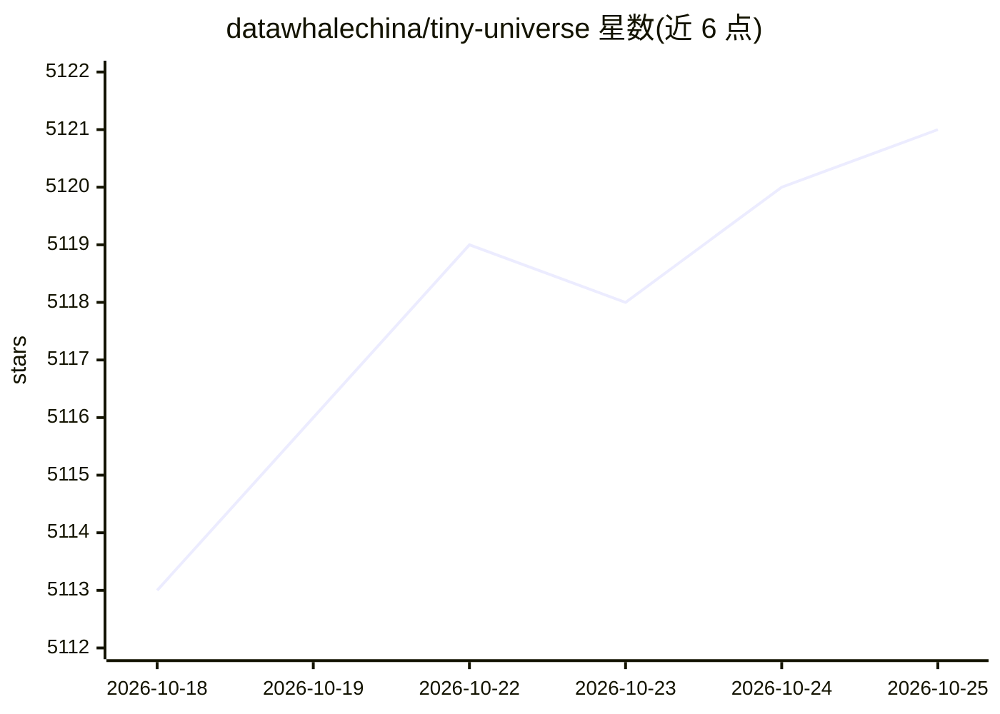

# datawhalechina/tiny-universe

⭐ 5,123 · Jupyter Notebook · 推送 2026-02-12 · [GitHub](https://github.com/datawhalechina/tiny-universe) · 组织维护 · 中文 README

**手搓大模型全链路教程：从零实现 LLM/RAG/Agent/评估**

Datawhale 维护的《大模型白盒子构建指南》：面向有深度学习基础的学习者，抛弃高度封装框架，从 PyTorch/Numpy 层出发从零实现大模型全链路组件，包括 Tiny Diffusion（DDPM）、Tiny Transformer、Tiny Llama3 预训练（约 2G 显存即可完成）、Qwen2 结构解析、Tiny RAG、Tiny GraphRAG、Tiny Agent（ReAct 结构）与 Tiny Eval 评测体系，另含学术论文复现（CDDRS）。以教程加代码注释形式提供，配讲解视频，采用 CC BY-NC-SA 4.0 许可。

## 筛选速览

| 维度 | 判定 | 备注 |
|---|---|---|
| AI 角色 | `ai-knowledge` | 知识聚合/清单类 |
| 许可风险 | `none` | — |
| 部署形态 | `None` |  |
| 模型依赖 | — | README 未给出锁定关系 |
| 硬件要求 | `gpu-8g` | |
| 安装摩擦 | `low` | 无编译、无系统依赖或容器化 |
| 成熟度 | — | 结构信号不足 |

## 能力要点

- 从零手搓 LLM 全链路：模型预训练、RAG、GraphRAG、Agent、评估体系
- TinyLlama3 预训练到推理约 2G 显存即可完成
- Qwen2 模型结构逐模块解析（GQA/ROPE/Attention Mask）
- 各子项目附讲解视频与代码注释

## 适用场景

- 有 API 使用经验后想深入大模型底层原理
- 从零手写 RAG/Agent/评测代码以理解框架内部细节
- 在单卡低显存环境完整体验 LLM 预训练流程

## 场景标签

`教程课程` · 领域:学习与行业

## 证据(README 行号)

> L3: &emsp;&emsp;本项目是一个从原理出发、以“白盒”为导向、围绕大模型全链路的“手搓”大模型指南，旨在帮助有传统深度学习基础的读者从底层原理出发，“纯手搓”搭建一个清晰、可用的大模型系统，包括大模型本身、RAG 框架、Agen
> L30: &emsp;&emsp;目前，大部分教程目标在于指导开发者如何基于高度封装的 API、开源框架实现便捷、快速的开发和训练，有利于初学者入门，却忽视了掌握模型原理、框架内部细节的重要性。不管是大模型本身，还是基于大模型的赋能系统 R

## 星数曲线

2026-10-18 5,113 → 2026-10-25 5,121（+8）

---
*卡片 v1 · prompt 1.4 · 生成 2026-10-20 · 置信度 high · 依据 README sha `f3ac7af7203d` · [字段定义](../../DATASET.md)*
