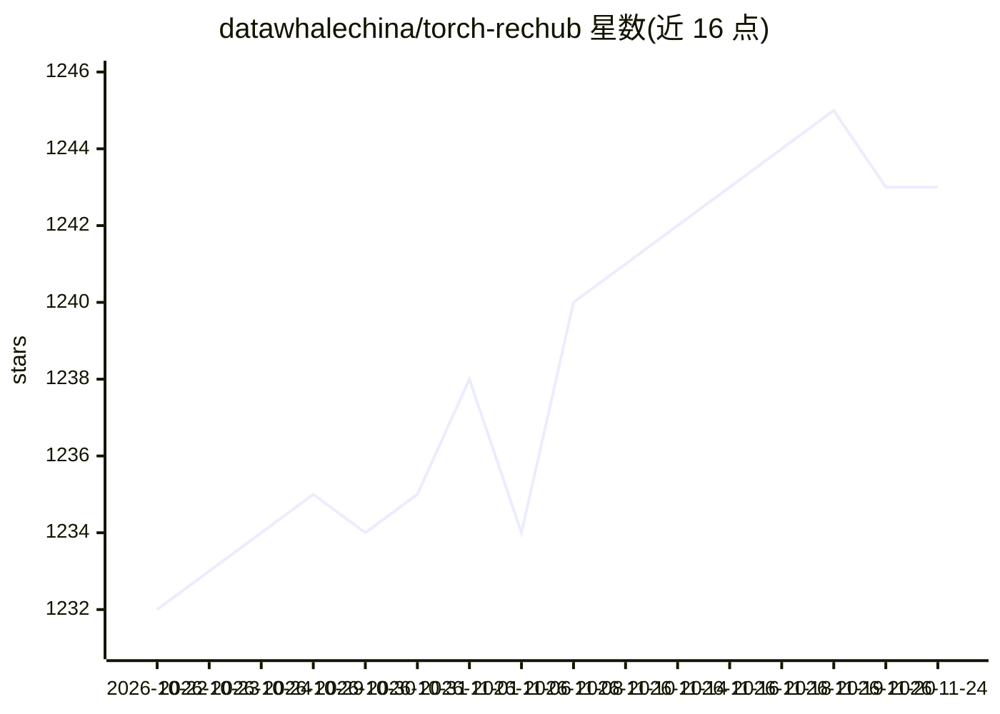

# datawhalechina/torch-rechub

⭐ 1,242 · Jupyter Notebook · MIT · 推送 2026-11-23 · [GitHub](https://github.com/datawhalechina/torch-rechub) · [官网](https://datawhalechina.github.io/torch-rechub/) · 组织维护 · 中文 README

**面向开发者的 PyTorch 推荐系统模型训练框架**

Datawhale 维护的推荐算法 PyTorch 框架，收录 30+ 模型及对应论文，覆盖检索（DSSM、YouTubeDNN 等）、排序（DeepFM、DIN 等）、多任务（MMoE、PLE 等）与序列/生成式推荐（HSTU、TIGER、RQ-VAE）。支持稀疏/稠密/序列特征组合与共享 embedding 表，每个任务配独立 trainer；检索模型可分别生成用户与物品向量后用 Annoy/Faiss/Milvus 做近邻搜索，部分模型可导出 ONNX。支持 Jupyter 示例教学、竞赛 baseline 训练与单机多卡训练，MIT 许可，中英双语文档。

## 筛选速览

| 维度 | 判定 | 备注 |
|---|---|---|
| AI 角色 | `ai-native` | 本体是模型或模型工具 |
| 许可风险 | `permissive` | MIT |
| 部署形态 | `library` | 以包/库形式分发 |
| 模型依赖 | — | README 未给出锁定关系 |
| 硬件要求 | — | 无带数字的原话,不猜 |
| 安装摩擦 | `medium` | 含编译或系统依赖之一 |
| 成熟度 | — | 结构信号不足 |

## 能力要点

- 30+ 推荐模型及配套论文，含检索/排序/多任务/生成式四类
- 检索模型双塔向量生成 + Annoy/Faiss/Milvus 近邻搜索
- 部分支持模型导出 ONNX 供推理服务使用
- 支持 NVIDIA(CUDA)/AMD(ROCm)/华为昇腾 NPU(CANN)/CPU 训练

## 适用场景

- 按论文逐步学习推荐模型的 PyTorch 实现
- 在统一数据划分上训练竞赛 baseline 并对比 AUC/Recall@K
- 小团队在单机多 GPU 上训练排序模型并导出 ONNX 部署

## 场景标签

`推荐系统` `模型训练` · 领域:学习与行业

## 证据(README 行号)

> L3: **Study 30+ PyTorch recommender models alongside their papers, from two-tower retrieval to generative recommendation
> L73: * **Retrieval** — DSSM, FaceBookDSSM, YouTubeDNN, YouTubeSBC, MIND, SINE, ComiRec (DR and SA), GRU4Rec, SASRec, NAR
> L74: * **Ranking** — Wide & Deep, DeepFM, DCN, DCNv2, EDCN, AFM, AutoInt, FiBiNET, DeepFFM, FAT-DeepFFM, DIN, DIEN, and 

## 星数曲线

2026-10-22 1,232 → 2026-11-24 1,243（+11）

---
*卡片 v1 · prompt 1.4 · 生成 2026-11-23 · 置信度 high · 依据 README sha `495c5cd08e39` · [字段定义](../../DATASET.md)*
