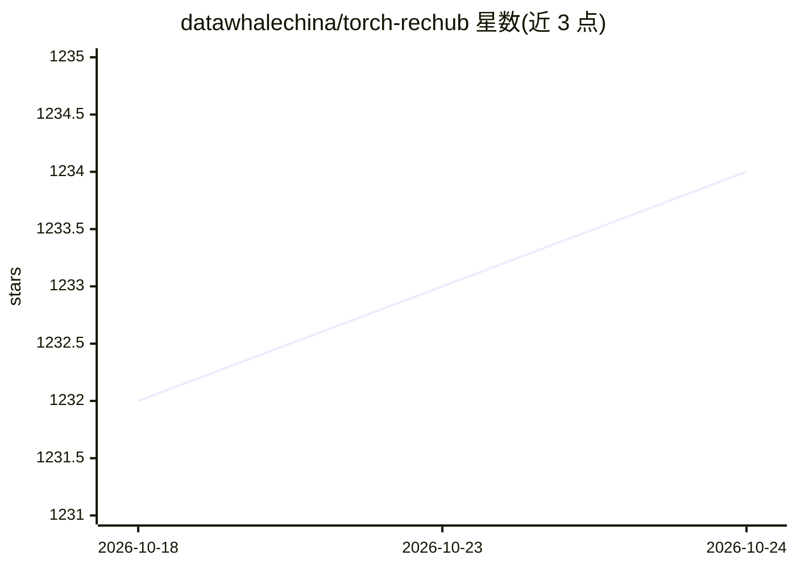

# datawhalechina/torch-rechub

⭐ 1,234 · Jupyter Notebook · MIT · 推送 2026-10-24 · [GitHub](https://github.com/datawhalechina/torch-rechub) · [官网](https://datawhalechina.github.io/torch-rechub/) · 组织维护 · 中文 README

**PyTorch 推荐系统框架：30+ 主流模型开箱即用并支持 ONNX 部署**

基于 PyTorch 的推荐算法框架，提供 30+ 个模型实现，覆盖排序（13）、匹配（12）、多任务（5）与生成式推荐（3，含 HSTU/HLLM/TIGER）四类；配套统一的数据加载、训练与评测流水线，提供 CTRTrainer 等训练器与 DataGenerator，声称约十行代码即可完成训练。支持导出 ONNX 部署、PySpark 数据处理及 WandB/SwanLab/TensorBoardX 实验跟踪。面向推荐算法工程师与研究者，支持 CPU/CUDA/ROCm/华为昇腾 NPU。

## 筛选速览

| 维度 | 判定 | 备注 |
|---|---|---|
| AI 角色 | `ai-native` | 本体是模型或模型工具 |
| 许可风险 | `permissive` | MIT |
| 部署形态 | `library` | 以包/库形式分发 |
| 模型依赖 | — | README 未给出锁定关系 |
| 硬件要求 | — | 无带数字的原话,不猜 |
| 安装摩擦 | `medium` | 含编译或系统依赖之一 |
| 成熟度 | — | 结构信号不足 |

## 能力要点

- 30+ 推荐模型实现（排序/匹配/多任务/生成式推荐四类）
- 统一训练与评测流水线，统一 Trainer 与 DataGenerator
- ONNX 导出与可选 Annoy/FAISS/Milvus 检索服务依赖组
- 支持 CPU、NVIDIA CUDA、AMD ROCm、华为昇腾 NPU

## 适用场景

- 用 DeepFM/DSSM 等模型在 MovieLens/Criteo 等数据集上训练 CTR 或召回模型
- 对比多种推荐算法的实验效果并跟踪记录
- 训练后导出 ONNX 用于线上部署

## 场景标签

`推荐系统` · 领域:学习与行业

## 证据(README 行号)

> L25: **Torch-RecHub** —— **Build production-grade recommender systems in 10 lines of code**. 30+ mainstream models out-o
> L31: * **Rich Model Library:** Covers **30+** classic and cutting-edge recommendation algorithms (Matching, Ranking, Mul
> L35: * **ONNX Export:** Export trained models to ONNX format for seamless production deployment.

## 星数曲线

2026-10-18 1,232 → 2026-10-24 1,234（+2）

---
*卡片 v1 · prompt 1.4 · 生成 2026-10-21 · 置信度 high · 依据 README sha `b5556f587d85` · [字段定义](../../DATASET.md)*
