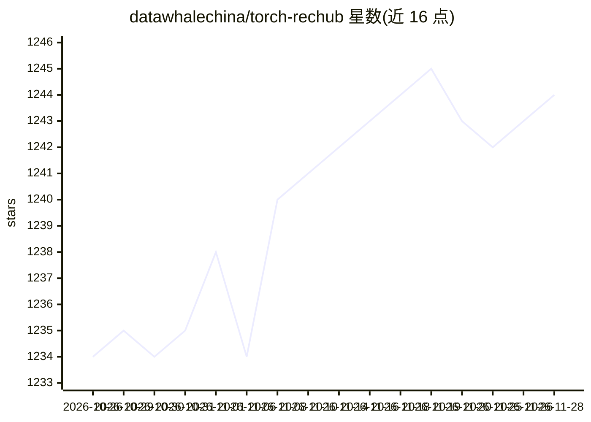

# datawhalechina/torch-rechub

⭐ 1,244 · Jupyter Notebook · MIT · 推送 2026-11-23 · [GitHub](https://github.com/datawhalechina/torch-rechub) · [官网](https://datawhalechina.github.io/torch-rechub/) · 组织维护 · 中文 README

**PyTorch 推荐系统学习与研究框架：训练 30+ 模型**

基于 PyTorch 的推荐模型框架，收录 30+ 模型及其论文，覆盖双塔召回、排序、多任务学习与生成式推荐（HSTU、HLLM、TIGER、RQ-VAE）。支持稀疏/稠密/序列特征组合与共享 embedding 表，可导出 ONNX，配合 Annoy/Faiss/Milvus 做近邻检索。面向教学自学、竞赛与小团队训练，附带 Jupyter 示例与 Criteo/MovieLens-1M 基准。限制：PyTorch 2.6+ 与 Python 3.10+。

## 筛选速览

| 维度 | 判定 | 备注 |
|---|---|---|
| AI 角色 | `ai-native` | 本体是模型或模型工具 |
| 许可风险 | `permissive` | MIT |
| 部署形态 | `library` | 以包/库形式分发 |
| 模型依赖 | — | README 未给出锁定关系 |
| 硬件要求 | — | 无带数字的原话,不猜 |
| 安装摩擦 | `medium` | 含编译或系统依赖之一 |
| 成熟度 | — | 结构信号不足 |

## 能力要点

- 30+ 推荐模型：召回、排序、多任务、生成式推荐四类
- 支持 CUDA/ROCm/华为昇腾 NPU/CPU 训练
- 双塔 embedding 生成与 Annoy/Faiss/Milvus 近邻检索
- 支持导出 ONNX，W&B/SwanLab/TensorBoardX 实验跟踪

## 适用场景

- 通过 Jupyter 示例学习推荐模型的特征交互与双塔召回
- 推荐竞赛中训练 baseline 并比较 AUC/Recall@K
- 小团队单机多卡训练排序模型并导出 ONNX 部署

## 场景标签

`推荐系统` · 领域:学习与行业

## 证据(README 行号)

> L3: **Study 30+ PyTorch recommender models alongside their papers, from two-tower retrieval to generative recommendation
> L22: * **Hardware support** — Train on NVIDIA GPUs (CUDA), AMD GPUs (ROCm), Huawei Ascend NPUs (CANN), or CPUs.

## 星数曲线

2026-10-26 1,234 → 2026-11-28 1,244（+10）

---
*卡片 v1 · prompt 1.4 · 生成 2026-11-25 · 置信度 high · 依据 README sha `fd2ef91ad905` · [字段定义](../../DATASET.md)*
