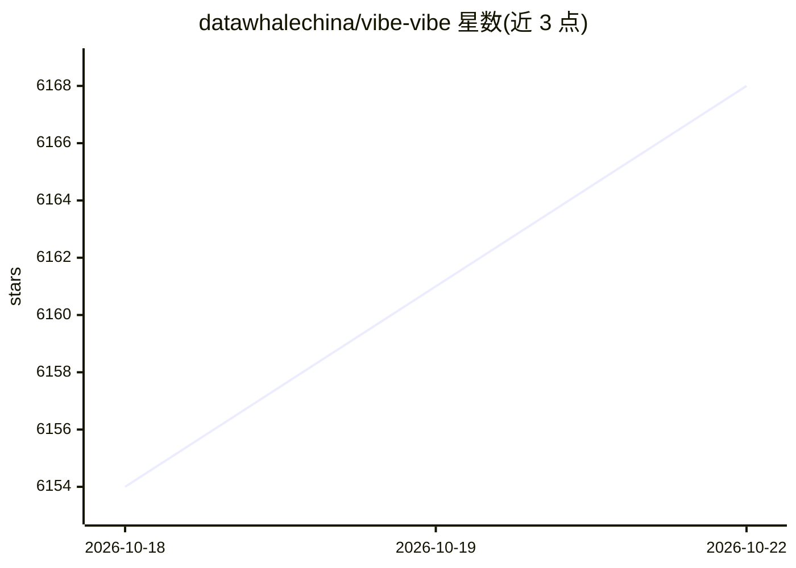

# datawhalechina/vibe-vibe

⭐ 6,168 · Dockerfile · 推送 2026-04-30 · [GitHub](https://github.com/datawhalechina/vibe-vibe) · [官网](https://www.vibevibe.cn) · 组织维护 · 中文 README

**零基础学习者的 Vibe Coding 系统化开源教程**

由 Datawhale 组织维护的 AI 辅助编程教程，践行 Andrej Karpathy 提出的 Vibe Coding 理念，通过自然语言对话让零基础者从想法走到产品上线。内容分四大板块：基础篇（入门与第一个项目）、进阶篇（16 章从 0 到上线的避坑指南）、实践篇（分人群项目实战）、优质文章篇（资源与前沿追踪）。提供在线阅读站点，并附带 Dockerfile 与 docker-compose.yml 支持私有化部署，默认端口 1024。教程内容以 CC BY-NC-SA 4.0 许可发布；README 预告了尚未上线的在线 IDE 与 AI Skills，属未来计划。

## 筛选速览

| 维度 | 判定 | 备注 |
|---|---|---|
| AI 角色 | `ai-knowledge` | 知识聚合/清单类 |
| 许可风险 | `none` | — |
| 部署形态 | `self-host` | docker 或自建部署 |
| 模型依赖 | — | README 未给出锁定关系 |
| 硬件要求 | — | 无带数字的原话,不猜 |
| 安装摩擦 | `low` | 无编译、无系统依赖或容器化 |
| 成熟度 | — | 结构信号不足 |

## 能力要点

- 四大板块结构：基础/进阶（16章）/实践/优质文章
- 面向零编程基础者，给出分人群的推荐学习起点
- 提供 Dockerfile 与 docker-compose.yml 私有化部署，默认 localhost:1024
- 进阶篇覆盖从 0 到上线的完整项目交付流程

## 适用场景

- 零基础学 AI 辅助编程并完成第一个项目
- 有编程基础的开发者学习 Vibe Coding 完整交付流程
- 企业或内网私有化部署教程站点供团队学习

## 场景标签

`教程课程` · 领域:学习与行业

## 证据(README 行号)

> L8: # Vibe Vibe —— 人人都能学会的 AI 编程（Vibe Coding）指南
> L45: 国内首个系统化的 Vibe Coding 开源教程，分为四大板块：
> L49: |📘 **基础篇**|AI 编程入门 + 心法 + 第一个项目|完全零基础、用过 ChatGPT 但没做过项目|

## 星数曲线

2026-10-18 6,154 → 2026-10-22 6,168（+14）

---
*卡片 v1 · prompt 1.4 · 生成 2026-10-20 · 置信度 high · 依据 README sha `353d76ee1df7` · [字段定义](../../DATASET.md)*
