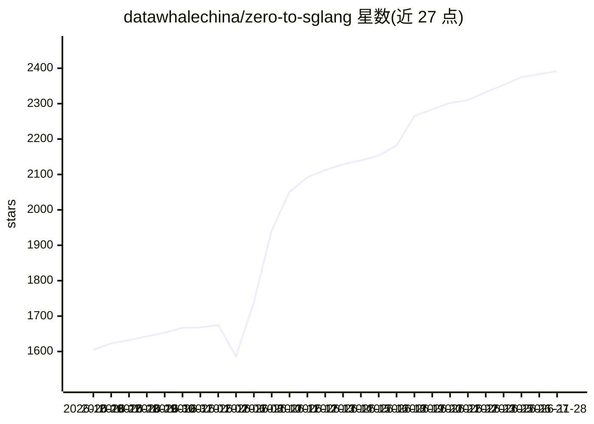

# datawhalechina/zero-to-sglang

⭐ 2,392 · Python · 推送 2026-11-17 · [GitHub](https://github.com/datawhalechina/zero-to-sglang) · [官网](https://datawhalechina.github.io/zero-to-sglang/) · 组织维护 · 中文 README

**从零构建 mini-sglang 的 LLM 推理教程课程**

Datawhale 与 RadixArk（SGLang 团队创立的公司）联合推出的 LLM 推理课程，提供英文与中文双语版本。内容分五部分：推理基础概念（KV Cache、prefill/decode、benchmark 指标）、从零手写 mini-sglang（前向生成、HTTP 服务、Continuous Batching、Paged KV Cache、RadixAttention）、对照真实 SGLang 源码讲解前沿优化（量化、分层缓存、PD 分离），以及 profiling 与 SGLang PR 工作流。Part I 无需 GPU，Part II 大部分可在 CPU 调试，完整性能测试建议用 GPU。

## 筛选速览

| 维度 | 判定 | 备注 |
|---|---|---|
| AI 角色 | `ai-knowledge` | 知识聚合/清单类 |
| 许可风险 | `none` | — |
| 部署形态 | `None` |  |
| 模型依赖 | — | README 未给出锁定关系 |
| 硬件要求 | — | 无带数字的原话,不猜 |
| 安装摩擦 | `medium` | 含编译或系统依赖之一 |
| 成熟度 | — | 结构信号不足 |

## 能力要点

- 从 0 到 1 手写 mini-sglang，每步落地代码
- 对照真实 SGLang 源码讲解 RadixAttention、Paged KV Cache、Continuous Batching 实现
- 覆盖量化、分层缓存、DP Attention/EP/PP、Prefill-Decode 分离等前沿主题
- 包含 profiling、trace 分析与完整 SGLang PR 工作流

## 适用场景

- 系统学习 LLM 推理引擎的原理与实现
- 为向 SGLang 贡献首个 PR 做准备
- 在 CPU 上调试 mini-sglang，在 GPU 云环境做性能测试

## 场景标签

`教程课程` · 领域:学习与行业

## 证据(README 行号)

> L8:  A hands-on tutorial on LLM inference: build a mini-sglang from scratch, then read the real SGLang source.
> L26: &emsp;&emsp;This course fills that gap. The first half starts from the core questions of inference: why KV Cache ex
> L64: |Part I — Foundations (concepts only, no code, no GPU)|||

## 星数曲线

2026-10-26 1,605 → 2026-11-28 2,392（+787）

---
*卡片 v1 · prompt 1.4 · 生成 2026-11-23 · 置信度 high · 依据 README sha `73e311a0e8fe` · [字段定义](../../DATASET.md)*
