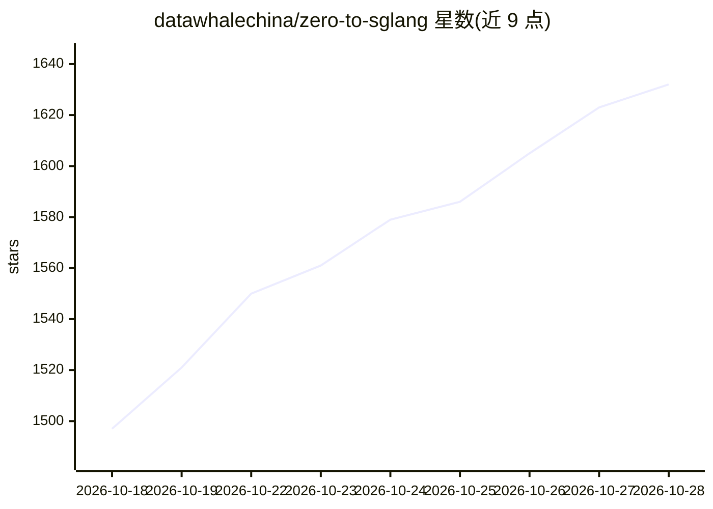

# datawhalechina/zero-to-sglang

⭐ 1,632 · Python · 推送 2026-10-26 · [GitHub](https://github.com/datawhalechina/zero-to-sglang) · [官网](https://datawhalechina.github.io/zero-to-sglang/) · 组织维护 · 中文 README

**从零构建 LLM 推理引擎的 SGLang 实战教程课程**

由 Datawhale 与 RadixArk（SGLang 团队创立的公司）联合推出的 LLM 推理教程：先讲解 KV Cache、prefill/decode、compute-bound 等推理基础概念，随后带领学习者从 0 到 1 手写 mini-sglang（前向传播、KV Cache、HTTP 服务、Continuous Batching、Paged KV Cache、RadixAttention），最后深入真实 SGLang 源码讲解量化、分层缓存等优化并指导完成首个 PR。课程仍在开发中（Part II/III 部分章节进行中），提供中英双语版本，Part I 无需 GPU，Part II 多数代码可在 CPU 上调试。

## 筛选速览

| 维度 | 判定 | 备注 |
|---|---|---|
| AI 角色 | `ai-knowledge` | 知识聚合/清单类 |
| 许可风险 | `none` | — |
| 部署形态 | `None` |  |
| 模型依赖 | — | README 未给出锁定关系 |
| 硬件要求 | — | 无带数字的原话,不猜 |
| 安装摩擦 | `medium` | 含编译或系统依赖之一 |
| 成熟度 | `idea` | |

## 能力要点

- 四阶段课程：推理概念 → 手写 mini-sglang → 深读 SGLang 源码 → 贡献 PR
- 覆盖 KV Cache、Continuous Batching、Paged KV Cache、RadixAttention 等核心机制
- Part I 无需 GPU，Part II 大部分可在 CPU 调试
- 中英双语版本，部分章节由 SGLang 核心成员撰写

## 适用场景

- 系统学习 LLM 推理引擎的原理与实现
- 跟随教程从零手写一个 mini-sglang
- 为向 SGLang 贡献代码做准备（profiling 与 PR 流程）

## 场景标签

`教程课程` · 领域:学习与行业

## 证据(README 行号)

> L8:  A hands-on tutorial on LLM inference: build a mini-sglang from scratch, then read the real SGLang source.
> L25: &emsp;&emsp;This course fills that gap. The first half starts from the core questions of inference: why KV Cache ex

## 星数曲线

2026-10-18 1,497 → 2026-10-28 1,632（+135）

---
*卡片 v1 · prompt 1.4 · 生成 2026-10-21 · 置信度 high · 依据 README sha `157684096c73` · [字段定义](../../DATASET.md)*
