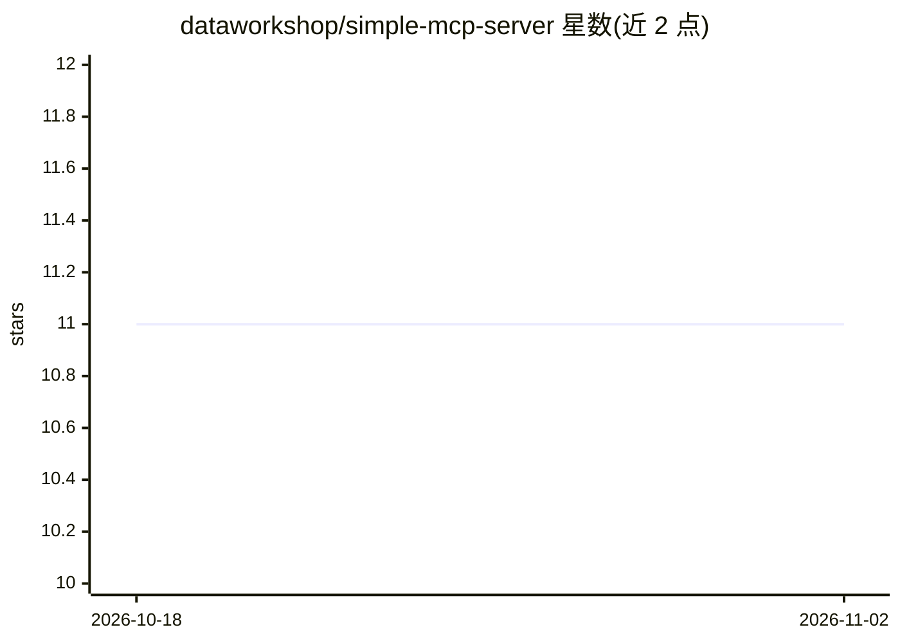

# dataworkshop/simple-mcp-server

⭐ 11 · Python · MIT · 推送 2025-11-06 · [GitHub](https://github.com/dataworkshop/simple-mcp-server) · 个人维护

**教学用最小 MCP 服务器：演示协议与三种客户端实现**

基于 FastMCP 构建的最小 Model Context Protocol 服务器，提供 generate_uuid、温度转换、文本统计三个工具，通过 Streamable HTTP 传输在 /mcp 端点提供服务，响应格式为 SSE，会话由 Mcp-Session-Id 头管理。仓库定位为教学示例，附三种客户端实现对照：官方 MCP Python SDK 版、仅依赖 httpx 的手写 JSON-RPC 版，以及仅用 curl 与 jq 的 bash 版，帮助开发者理解 MCP 协议工作方式。需 Python 3.13+，用 uv 安装依赖并运行。

## 筛选速览

| 维度 | 判定 | 备注 |
|---|---|---|
| AI 角色 | `ai-ecosystem` | LLM/agent 周边工具 |
| 许可风险 | `permissive` | MIT |
| 部署形态 | `None` |  |
| 模型依赖 | — | README 未给出锁定关系 |
| 硬件要求 | — | 无带数字的原话,不猜 |
| 安装摩擦 | `low` | 无编译、无系统依赖或容器化 |
| 成熟度 | — | 结构信号不足 |

## 能力要点

- 三个工具：UUID 生成、摄氏/华氏温度转换、基础文本统计
- Streamable HTTP 传输，/mcp 端点，SSE 响应与会话 ID 管理
- 三种客户端实现对照：FastMCP SDK / 纯 httpx / curl+jq
- uv sync 安装、uv run 启动

## 适用场景

- 学习 MCP 协议的通信流程与会话机制
- 对照不同技术栈（SDK/纯 HTTP/命令行）实现 MCP 客户端
- 作为自建 MCP 服务器的最小参考模板

## 场景标签

`教程课程` · 领域:学习与行业

## 证据(README 行号)

> L3: A simple Model Context Protocol (MCP) server built with FastMCP, featuring three utility tools.
> L87: - **Transport**: Streamable HTTP (MCP protocol over HTTP)

## 星数曲线

2026-10-18 11 → 2026-11-02 11（+0）

---
*卡片 v1 · prompt 1.4 · 生成 2026-11-02 · 置信度 high · 依据 README sha `91458d4b9bb4` · [字段定义](../../DATASET.md)*
