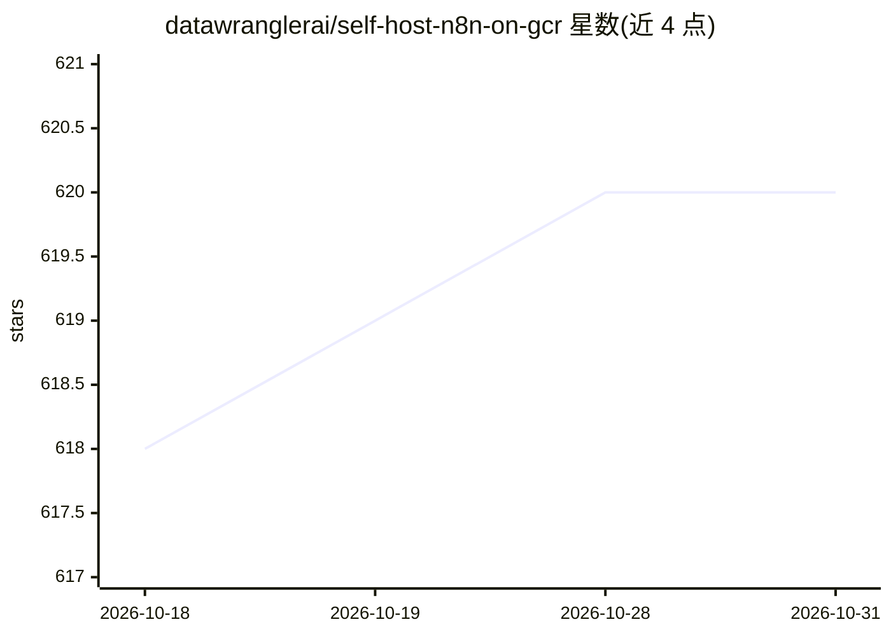

# datawranglerai/self-host-n8n-on-gcr

⭐ 620 · HCL · MIT · 推送 2026-05-13 · [GitHub](https://github.com/datawranglerai/self-host-n8n-on-gcr) · 个人维护

**在 Google Cloud Run 上自部署 n8n 的分步部署指南**

一份将 n8n 工作流自动化平台部署到 Google Cloud Run 的操作指南仓库：提供手动分步流程（gcloud 命令）与 Terraform 自动化部署两种路径，涵盖 Cloud SQL PostgreSQL 持久化、Secret Manager 密钥管理、服务账号最小权限配置、OAuth 回调环境变量设置等。n8n 镜像部署提供官方镜像加命令覆盖（Option A）与自定义 Docker 镜像（Option B）两种方式，并附环境变量对照表与 Cloud Run 特定注意事项（如健康端点改名、单实例限制）。面向希望自托管 n8n、控制数据与成本的用户。

## 筛选速览

| 维度 | 判定 | 备注 |
|---|---|---|
| AI 角色 | `ai-knowledge` | 知识聚合/清单类 |
| 许可风险 | `permissive` | MIT |
| 部署形态 | `desktop` | 安装包/桌面程序 |
| 模型依赖 | — | README 未给出锁定关系 |
| 硬件要求 | — | 无带数字的原话,不猜 |
| 安装摩擦 | `low` | 无编译、无系统依赖或容器化 |
| 成熟度 | — | 结构信号不足 |

## 能力要点

- 手动 gcloud 分步部署与 Terraform 自动化部署两种路径
- 官方镜像命令覆盖（Option A）与自定义 Docker 镜像（Option B）两种方式
- 涵盖 Cloud SQL PostgreSQL、Secret Manager、服务账号与 OAuth 配置
- 提供 n8n 环境变量在两种方式下的对照表与 Cloud Run 适配说明

## 适用场景

- 在 Google Cloud Run 上低成本自托管 n8n
- 数据自主可控地运行自动化工作流
- 用 Terraform 一键复用整套 n8n 部署

## 场景标签

`工作流自动化` · 领域:效率与自动化

## 证据(README 行号)

> L1: # Self-Hosting n8n on Google Cloud Run: Complete Guide #
> L7: > **🚀 Quick Start Option**: Want to skip the manual setup? Jump to the Terraform Deployment Option section for a str
> L48: ## Step 1: Set Up Your Google Cloud Project ##

## 星数曲线

2026-10-18 618 → 2026-10-31 620（+2）

---
*卡片 v1 · prompt 1.4 · 生成 2026-10-21 · 置信度 mid · 依据 README sha `6b452f05c6b1` · [字段定义](../../DATASET.md)*
