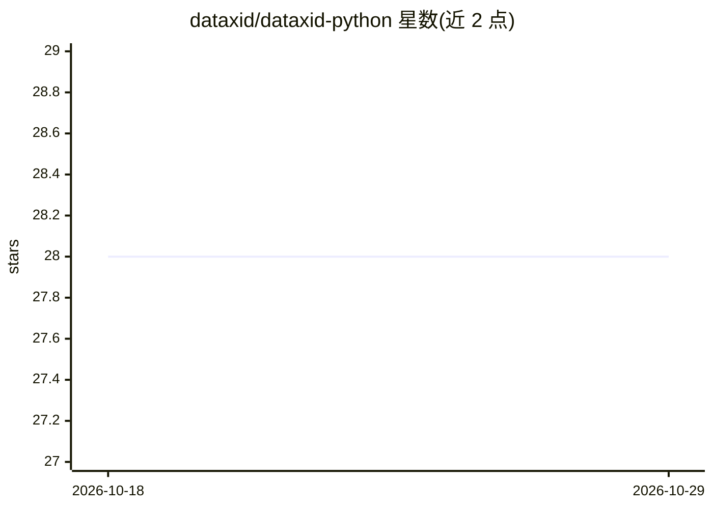

# dataxid/dataxid-python

⭐ 28 · Python · Apache-2.0 · 推送 2026-09-19 · [GitHub](https://github.com/dataxid/dataxid-python) · [官网](https://app.dataxid.com) · 组织维护

**Python SDK：调用 DataXID API 生成隐私安全的合成数据**

DataXID 的 Python SDK，用于生成单表、多表（保持引用完整性）和时间序列合成数据。采用 privacy-by-architecture 机制：数据编解码在本地完成，仅将抽象 embedding 发送至 API 训练模型，原始数据不离开本地环境；可选对 embedding 加高斯噪声、保护稀有类别值。支持训练/生成分离的迭代工作流、类别分布重平衡、偏差校正、条件生成、缺失值填充等。面向需要合成数据的开发者和数据团队；使用需调用云端 API。

## 筛选速览

| 维度 | 判定 | 备注 |
|---|---|---|
| AI 角色 | `ai-native` | 本体是模型或模型工具 |
| 许可风险 | `permissive` | Apache-2.0 |
| 部署形态 | `library` | 以包/库形式分发 |
| 模型依赖 | — | README 未给出锁定关系 |
| 硬件要求 | — | 无带数字的原话,不猜 |
| 安装摩擦 | `low` | 无编译、无系统依赖或容器化 |
| 成熟度 | — | 结构信号不足 |

## 能力要点

- 单表/多表/时间序列合成，多表保持引用完整性
- privacy-by-architecture：本地编解码，仅共享 embedding，可选高斯噪声与稀有值保护
- Model.create 与 model.generate 分离，一次训练多次生成
- 支持分布重平衡、偏差校正、条件生成、缺失值填充

## 适用场景

- 为模型训练或测试生成不泄露真实记录的合成数据
- 生成保持外键关系与时间模式的多表数据集
- 对合成数据做类别重平衡与敏感属性偏差校正

## 场景标签

 · 领域:合成数据/数据隐私

## 证据(README 行号)

> L7: High-fidelity synthetic data generation for single-table, multi-table, and time series data.
> L61: DataXID is built on a **privacy-by-architecture** principle. Data encoding and decoding happen entirely on your mac

## 星数曲线

2026-10-18 28 → 2026-10-29 28（+0）

---
*卡片 v1 · prompt 1.4 · 生成 2026-10-26 · 置信度 mid · 依据 README sha `7e857cf3c0ac` · [字段定义](../../DATASET.md)*
