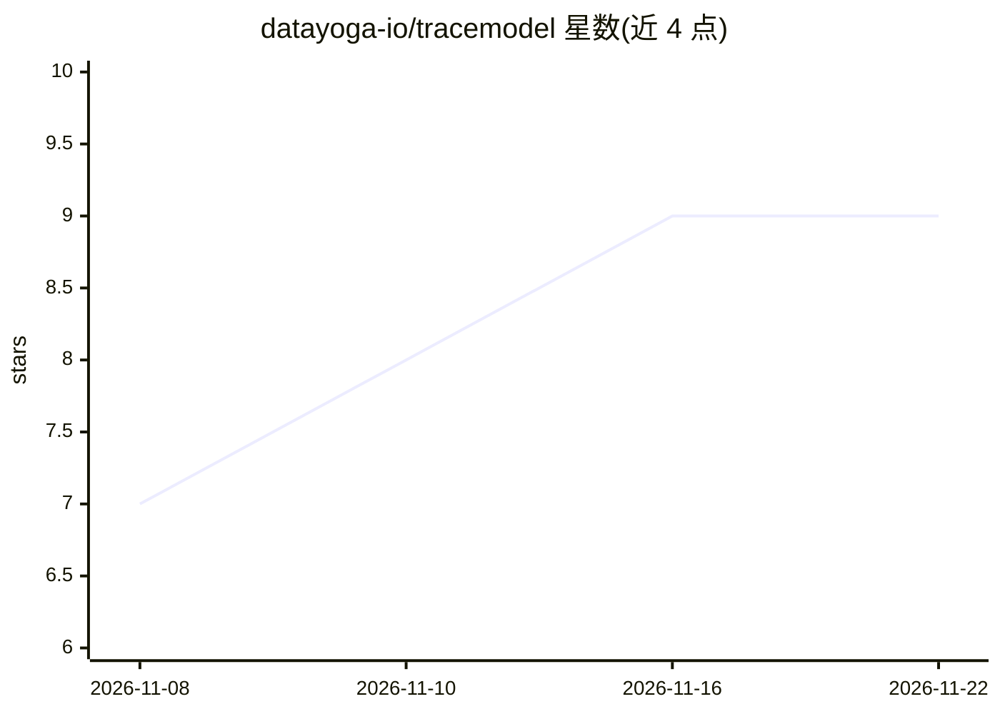

# datayoga-io/tracemodel

⭐ 9 · Python · Apache-2.0 · 推送 2026-11-20 · [GitHub](https://github.com/datayoga-io/tracemodel) · [官网](https://datayoga-io.github.io/tracemodel/) · 个人维护

**给 Python 财务建模加溯源与校验的库，供人与 AI agent 填数**

Python 库，用于构建带可追溯性的财务与业务模型：每个数值有固定地址、来源（文档/页码）和按标签运行的数据质量规则；提供 formula、check、precedents()/dependents()/explain() 等机制，支持 commits/branches 与按值接受或拒绝，可导出 Excel（to_excel）。定位为 AI agent 的结构化填充容器：agent 写入的值须通过定义校验，复核者可逐数回溯。需 Python 3.12+，公式经 RestrictedPython 安全执行。

## 筛选速览

| 维度 | 判定 | 备注 |
|---|---|---|
| AI 角色 | `ai-enhanced` | 去掉 AI 部分产品仍成立 |
| 许可风险 | `permissive` | Apache-2.0 |
| 部署形态 | `library` | 以包/库形式分发 |
| 模型依赖 | — | README 未给出锁定关系 |
| 硬件要求 | — | 无带数字的原话,不猜 |
| 安装摩擦 | `low` | 无编译、无系统依赖或容器化 |
| 成熟度 | — | 结构信号不足 |

## 能力要点

- 每个数值携带来源（document/page 等键），可回溯到原始页码
- 声明式检查按维度标签逐格运行，explain() 展示读取的每个单元格
- 支持层级维度、时间维度、commits/branches 与按值接受/拒绝
- to_excel() 导出，agent 写值须通过固定定义校验

## 适用场景

- 从财报/申报文件构建三表模型并给每个数字标注出处
- 让 AI agent 按固定定义抽取数值，自动拦截不合规填入
- 复核他人或 agent 建的模型，追踪任一单元格的前因后继

## 场景标签

`金融量化` · 领域:学习与行业

## 证据(README 行号)

> L8: tracemodel lets you build a financial model in Python in which every number has a fixed address,
> L85: Above all, tracemodel gives AI a **financial brain**. A language model can read a filing, but it
> L136: To run steps 1–3 and step 4 as two AI agents, see docs/agents.md.

## 星数曲线

2026-11-08 7 → 2026-11-22 9（+2）

---
*卡片 v1 · prompt 1.4 · 生成 2026-11-20 · 置信度 high · 依据 README sha `6c11bfde41f7` · [字段定义](../../DATASET.md)*
