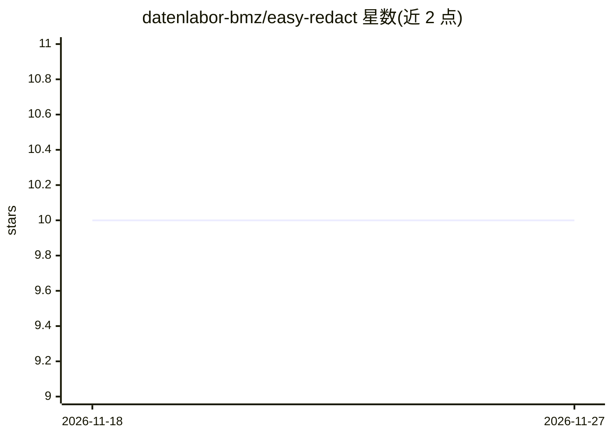

# datenlabor-bmz/easy-redact

⭐ 10 · TypeScript · AGPL-3.0 · 推送 2026-08-05 · [GitHub](https://github.com/datenlabor-bmz/easy-redact) · [官网](https://easyredact.io) · 组织维护

**为德国联邦部委提供的 AI 辅助 PDF/DOCX 敏感信息涂黑工具**

面向德国联邦部委的浏览器端 PDF 涂黑（redaction）工具：上传 PDF 或 DOCX，由 AI 在交互式对话中建议涂黑项（含置信度、涉及人员与法律依据），用户审核调整后导出涂黑文档。支持 PII 与 FOI/IFG 两种模式，云端与本地 AI 可切换，文档默认不出本机。本地模式可选 Ollama/vLLM/llama.cpp 或 spaCy 德语 NER；DOCX 转换与 spaCy NLP 仅在 Docker 部署中可用。以 AGPL-3.0 许可发布，由 BMZ DataLab 构建。

## 筛选速览

| 维度 | 判定 | 备注 |
|---|---|---|
| AI 角色 | `ai-native` | 本体是模型或模型工具 |
| 许可风险 | `viral` | AGPL-3.0 |
| 部署形态 | `self-host` | docker 或自建部署 |
| 模型依赖 | local-ok | 支持本地模型 |
| 硬件要求 | — | 无带数字的原话,不猜 |
| 安装摩擦 | `low` | 无编译、无系统依赖或容器化 |
| 成熟度 | — | 结构信号不足 |

## 能力要点

- PII 与 FOI/IFG 两种涂黑模式，FOI 规则可本地打包或运行时拉取
- 云端 OpenAI 兼容端点与本地 AI（Ollama/vLLM/llama.cpp/spaCy NER）可随时切换
- 纯浏览器端渲染与涂黑，文档不离开本机（air-gapped 部署可选）
- 手动涂黑、多文档标签页与 IndexedDB 会话持久化

## 适用场景

- 发布政府文件前涂黑个人信息
- 按信息自由法豁免条款处理 FOI 申请回复
- 离线环境中对涉密文档做本地涂黑

## 场景标签

 · 领域:政府/文档隐私处理

## 证据(README 行号)

> L5: AI-assisted PDF redaction tool for German federal ministries (BMZ). Upload a PDF or DOCX, have the AI suggest redact
> L17: - **AI chat assistant** — reads the document, asks targeted clarifying questions, then suggests redactions with exa
> L89: |On-premise (GPU)|`true`|`llm`|Cloud AI + local LLM (Ollama, vLLM, llama.cpp)|

## 星数曲线

2026-11-18 10 → 2026-11-27 10（+0）

---
*卡片 v1 · prompt 1.4 · 生成 2026-11-19 · 置信度 high · 依据 README sha `ba9fc7eaddf3` · [字段定义](../../DATASET.md)*
