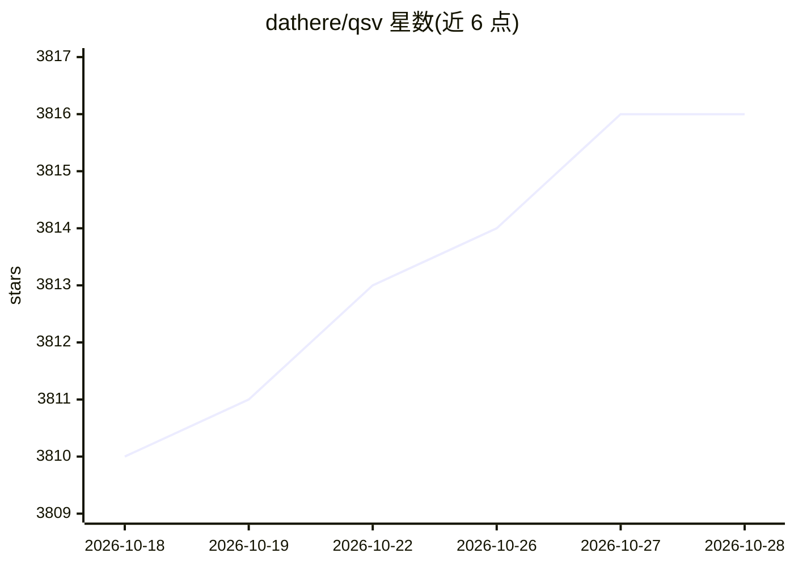

# dathere/qsv

⭐ 3,818 · Rust · NOASSERTION · 推送 2026-10-28 · [GitHub](https://github.com/dathere/qsv) · [官网](https://qsv.dathere.com) · 组织维护

**命令行数据清洗工具集，处理/校验/富化 CSV 等表格数据**

用 Rust 编写的表格数据命令行工具集，提供 40+ 个可组合命令，覆盖查询、切片、排序、统计、去重、连接、透视、格式转换、校验与 FAIR 元数据化（DCAT/Croissant scheming），支持 CSV、Excel 及 polars 特性下的 Parquet/Arrow/JSON 等格式；geocode 命令基于本地 Geonames/GeoLite2 副本离线地理编码，luau 命令提供 DSL 构建数据管道。AI 相关功能为可选：describegpt 用任意 OpenAI API 兼容 LLM 推断数据字典与标签，apply 的 summarize 子命令做列摘要；另提供 MCP Server 安装方式。

## 筛选速览

| 维度 | 判定 | 备注 |
|---|---|---|
| AI 角色 | `ai-enhanced` | 去掉 AI 部分产品仍成立 |
| 许可风险 | `none` | NOASSERTION |
| 部署形态 | `library` | 以包/库形式分发 |
| 模型依赖 | — | README 未给出锁定关系 |
| 硬件要求 | — | 无带数字的原话,不猜 |
| 安装摩擦 | `medium` | 含编译或系统依赖之一 |
| 成熟度 | — | 结构信号不足 |

## 能力要点

- 40+ 可组合命令覆盖查询/统计/连接/透视/校验等数据清洗操作
- describegpt 经任意 OpenAI API 兼容 LLM（云端或本地）推断数据字典与标签
- geocode 支持本地 Geonames/GeoLite2 离线地理编码（可达每秒数十万条）
- luau DSL 支持随机访问与查找表构建数据管道，joinp 可处理大于内存的文件

## 适用场景

- 对大体积 CSV/Excel 数据做快速清洗、统计与转换
- 为数据集生成数据字典、元数据并做 FAIR 化
- 批量地理编码并在离线环境下运行
- 用 LLM 对列做摘要或对数据提问（SQL RAG）

## 场景标签

 · 领域:数据工程/表格数据处理

## 证据(README 行号)

> L15: qsv logo _Hi-ho "Quicksilver" away!_ original logo details * Base AI-reimagined logo * Event logo archive |qsv is a
> L21: |apply✨ 📇🧠🤖🚀🔣👆⛩️|Apply series of string, date, math & currency transformations to given CSV column/s. It also has s
> L33: |describegpt 📇🗃️🤖🌐🪄📚⛩️ CKAN|Infer a "neuro-symbolic" Data Dictionary, Description & Tags or ask questions about a C

## 星数曲线

2026-10-18 3,810 → 2026-10-28 3,816（+6）

---
*卡片 v1 · prompt 1.4 · 生成 2026-10-20 · 置信度 mid · 依据 README sha `876f35d448ce` · [字段定义](../../DATASET.md)*
