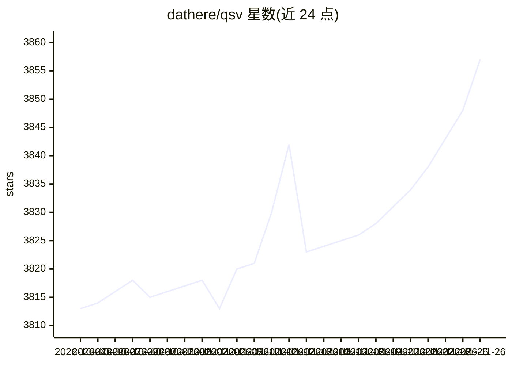

# dathere/qsv

⭐ 3,857 · Rust · NOASSERTION · 推送 2026-11-25 · [GitHub](https://github.com/dathere/qsv) · [官网](https://qsv.dathere.com) · 组织维护

**给数据工作者的高性能表格数据整理命令行工具集**

Rust 编写的神经符号数据整理工具包，支持 CSV/TSV/JSONL/Parquet/电子表格的查询、切片、排序、统计、过滤、富化、地理编码、验证与 FAIR 化。多个命令可调用 OpenAI API 兼容的本地或云端 LLM（如 apply 的 summarize、describegpt 生成数据字典/描述/标签、SQL RAG 问答），另提供 MCP Server 与 Cowork Plugin 安装路径。命令可组合，含索引加速与 Polars 引擎选项。

## 筛选速览

| 维度 | 判定 | 备注 |
|---|---|---|
| AI 角色 | `ai-enhanced` | 去掉 AI 部分产品仍成立 |
| 许可风险 | `none` | NOASSERTION |
| 部署形态 | `library` | 以包/库形式分发 |
| 模型依赖 | — | README 未给出锁定关系 |
| 硬件要求 | — | 无带数字的原话,不猜 |
| 安装摩擦 | `medium` | 含编译或系统依赖之一 |
| 成熟度 | — | 结构信号不足 |

## 能力要点

- 覆盖数据整理全流程的可组合命令集（join/dedup/stats/schema 等）
- describegpt 等命令支持任意 OpenAI API 兼容的本地/云端 LLM
- 离线地理编码（Geonames/GeoLite2）可达每秒 36 万条记录
- luau 脚本作为 DSL 构建生产数据管道，支持 MCP Server 接入

## 适用场景

- 批量清洗、验证与转换 CSV 数据文件
- 用 LLM 为数据集生成数据字典、描述与标签
- 对地址数据做离线地理编码富化
- 为 CKAN 数据门户做 DCAT 元数据 FAIR 化

## 场景标签

`数据分析` `工作流自动化` · 领域:效率与自动化

## 证据(README 行号)

> L1: ## qsv: Blazing-fast Neuro-symbolic Data-Wrangling toolkit
> L16: qsv logo _Hi-ho "Quicksilver" away!_ original logo details * Base AI-reimagined logo * Event logo archive |qsv is a
> L34: |describegpt 📇🗃️🤖🌐🪄📚⛩️ CKAN|Infer a "neuro-symbolic" Data Dictionary, Description & Tags or ask questions about a C

## 星数曲线

2026-10-24 3,813 → 2026-11-26 3,857（+44）

---
*卡片 v1 · prompt 1.4 · 生成 2026-11-26 · 置信度 mid · 依据 README sha `f11711d7bd29` · [字段定义](../../DATASET.md)*
