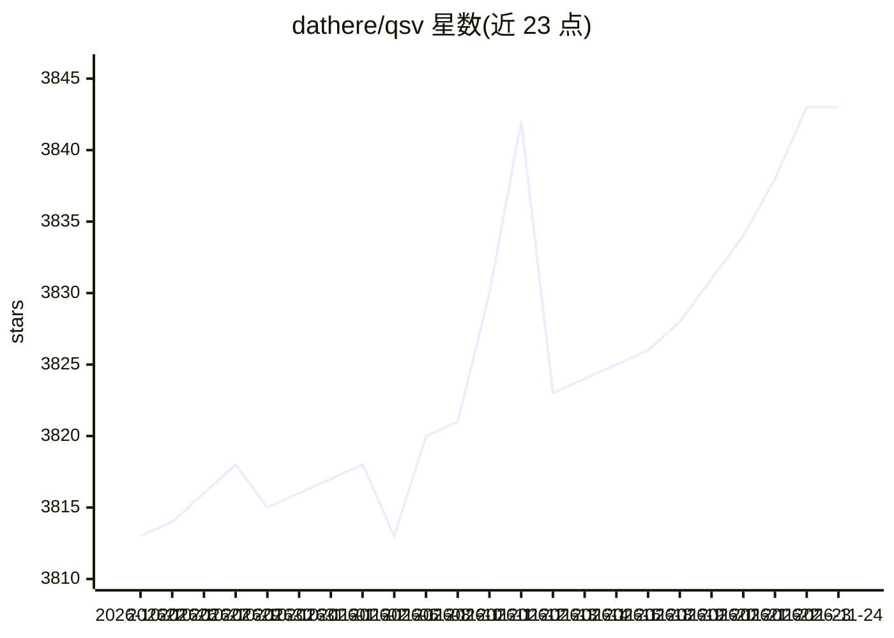

# dathere/qsv

⭐ 3,848 · Rust · NOASSERTION · 推送 2026-11-24 · [GitHub](https://github.com/dathere/qsv) · [官网](https://qsv.dathere.com) · 组织维护

**面向数据从业者的表格数据命令行处理工具箱**

Rust 编写的 CLI 工具箱，支持对 CSV/TSV/JSONL/parquet/电子表格等表格数据进行查询、切片、排序、统计、过滤、转换、校验、地理编码、格式转换、可视化与元数据生成（DCAT-US/DCAT-AP/Croissant）。命令可组合，部分命令借助索引与 Polars 引擎处理大文件。AI 相关能力以子命令形式存在：describegpt 可接任意 OpenAI API 兼容的本地或云 LLM 生成数据字典与 SQL RAG 问答，另有 MCP Server 与 Cowork Plugin 两种安装形态。

## 筛选速览

| 维度 | 判定 | 备注 |
|---|---|---|
| AI 角色 | `ai-enhanced` | 去掉 AI 部分产品仍成立 |
| 许可风险 | `none` | NOASSERTION |
| 部署形态 | `library` | 以包/库形式分发 |
| 模型依赖 | — | README 未给出锁定关系 |
| 硬件要求 | — | 无带数字的原话,不猜 |
| 安装摩擦 | `medium` | 含编译或系统依赖之一 |
| 成熟度 | — | 结构信号不足 |

## 能力要点

- 100+ 可组合子命令覆盖表格数据清洗、统计、校验、地理编码全流程
- describegpt 支持任意 OpenAI API 兼容 LLM 做数据描述与 SQL RAG 问答
- 支持 Luau 脚本与 Python 表达式作为数据处理 DSL
- 提供 CLI、MCP Server、Cowork Plugin 三种安装形态

## 适用场景

- 批量清洗、校验和转换大型 CSV 数据集
- 用 LLM 自动生成数据字典和元数据做 FAIR 化
- 离线地理编码和地址数据增强
- 为 CKAN 数据平台处理与富化开放数据

## 场景标签

`RAG` `数据分析` · 领域:效率与自动化

## 证据(README 行号)

> L16: qsv logo _Hi-ho "Quicksilver" away!_ original logo details * Base AI-reimagined logo * Event logo archive |qsv is a
> L22: |apply✨ 📇🧠🤖🚀🔣👆⛩️|Apply series of string, date, math & currency transformations to given CSV column/s. It also has s
> L34: |describegpt 📇🗃️🤖🌐🪄📚⛩️ CKAN|Infer a "neuro-symbolic" Data Dictionary, Description & Tags or ask questions about a C

## 星数曲线

2026-10-22 3,813 → 2026-11-24 3,843（+30）

---
*卡片 v1 · prompt 1.4 · 生成 2026-11-24 · 置信度 low · 依据 README sha `615bdb95f01e` · [字段定义](../../DATASET.md)*
