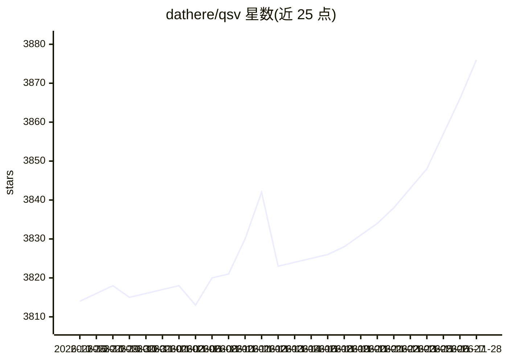

# dathere/qsv

⭐ 3,876 · Rust · NOASSERTION · 推送 2026-11-27 · [GitHub](https://github.com/dathere/qsv) · [官网](https://qsv.dathere.com) · 组织维护

**面向数据处理者的 CSV/表格数据清洗与增强 CLI 工具集**

Rust 编写的表格数据（CSV/TSV/JSONL/parquet/表格文件）命令行工具集，覆盖查询、切片、排序、统计分析、过滤、转换、校验、地理编码、格式转换、可视化与文档化等操作，命令可组合使用。其中部分命令嵌入 AI 能力：describegpt/apply 可调用任意 OpenAI API 兼容的本地或云端 LLM 生成数据字典、描述与标签或做 SQL RAG 问答；geocode 支持离线 Geonames/GeoLite2 与在线 OpenCage 等服务。安装方式包括 cargo、预编译包等，另有 MCP Server 与 Cowork Plugin 形式。

## 筛选速览

| 维度 | 判定 | 备注 |
|---|---|---|
| AI 角色 | `ai-enhanced` | 去掉 AI 部分产品仍成立 |
| 许可风险 | `none` | NOASSERTION |
| 部署形态 | `library` | 以包/库形式分发 |
| 模型依赖 | — | README 未给出锁定关系 |
| 硬件要求 | — | 无带数字的原话,不猜 |
| 安装摩擦 | `medium` | 含编译或系统依赖之一 |
| 成熟度 | — | 结构信号不足 |

## 能力要点

- 100+ 可组合命令处理 CSV/JSONL/parquet/Excel 等表格数据
- describegpt/apply 等命令支持任意 OpenAI API 兼容 LLM（本地或商业）
- geocode 支持离线 Geonames/GeoLite2 与在线 OpenCage/Geoclient/US Census
- luau 脚本引擎作为内置 DSL 构建数据管道，支持 DCAT/CKAN 元数据 FAIRification

## 适用场景

- 清洗、校验和转换大规模 CSV 数据文件
- 用 LLM 自动为数据集生成数据字典、标签与描述
- 对地址数据做批量地理编码与人口普查数据富化
- 为开放数据门户准备 DCAT/CKAN 元数据

## 场景标签

`数据分析` · 领域:效率与自动化

## 证据(README 行号)

> L16: qsv logo _Hi-ho "Quicksilver" away!_ original logo details * Base AI-reimagined logo * Event logo archive |qsv is a
> L22: |apply✨ 📇🧠🤖🚀🔣👆⛩️|Apply series of string, date, math & currency transformations to given CSV column/s. It also has s
> L34: |describegpt 📇🗃️🤖🌐🪄📚⛩️ CKAN|Infer a "neuro-symbolic" Data Dictionary, Description & Tags or ask questions about a C

## 星数曲线

2026-10-26 3,814 → 2026-11-28 3,876（+62）

---
*卡片 v1 · prompt 1.4 · 生成 2026-11-28 · 置信度 mid · 依据 README sha `6b4fd8cb6244` · [字段定义](../../DATASET.md)*
