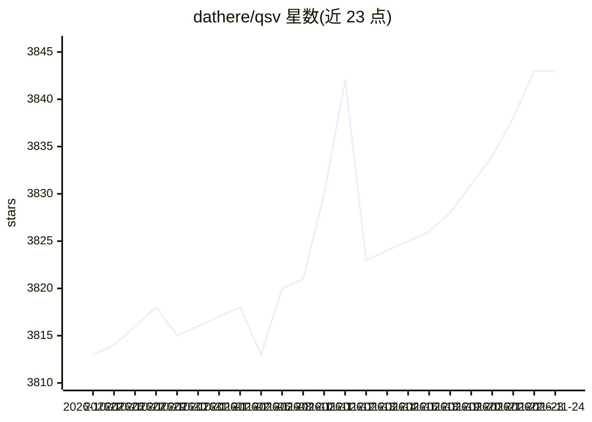

# dathere/qsv

⭐ 3,843 · Rust · NOASSERTION · 推送 2026-11-22 · [GitHub](https://github.com/dathere/qsv) · [官网](https://qsv.dathere.com) · 组织维护

**面向数据工程者的神经符号 CSV 数据整备命令行工具集**

以 Rust 编写的 CLI 工具集，覆盖表格数据（CSV/TSV/JSONL/parquet/电子表格）的查询、切片、排序、统计、清洗、地理编码、格式转换、验证与文档化等环节，命令可组合，支持索引加速与多线程。AI 相关机制：describegpt 命令通过任意 OpenAI API 兼容的云端/本地 LLM 生成数据字典、描述与标签，或以 SQL RAG 方式回答 CSV 问题；pro 命令对接 qsv pro API。提供 CLI、MCP Server、Cowork Plugin 多种安装形态。

## 筛选速览

| 维度 | 判定 | 备注 |
|---|---|---|
| AI 角色 | `ai-enhanced` | 去掉 AI 部分产品仍成立 |
| 许可风险 | `none` | NOASSERTION |
| 部署形态 | `library` | 以包/库形式分发 |
| 模型依赖 | — | README 未给出锁定关系 |
| 硬件要求 | — | 无带数字的原话,不猜 |
| 安装摩擦 | `medium` | 含编译或系统依赖之一 |
| 成熟度 | — | 结构信号不足 |

## 能力要点

- describegpt 使用任意 OpenAI API 兼容 LLM 推断数据字典/描述/标签，并支持确定性 SQL RAG 问答
- luau 内嵌脚本 DSL 支持构建含查找表的生产级数据管道
- geocode 支持本地离线 Geonames/GeoLite2 数据库与多线程缓存
- profile 支持 DCAT-US v3、DCAT-AP v3、Croissant 1.1 元数据模式做规模化 FAIR 化

## 适用场景

- 对大型 CSV 做统计、去重、清洗与格式转换
- 用 LLM 自动为数据集生成数据字典与标签
- 对地址数据做离线批量地理编码
- 为开放数据门户生成 FAIR 元数据

## 场景标签

`RAG` · 领域:知识与检索

## 证据(README 行号)

> L16: qsv logo _Hi-ho "Quicksilver" away!_ original logo details * Base AI-reimagined logo * Event logo archive |qsv is a
> L22: |apply✨ 📇🧠🤖🚀🔣👆⛩️|Apply series of string, date, math & currency transformations to given CSV column/s. It also has s
> L34: |describegpt 📇🗃️🤖🌐🪄📚⛩️ CKAN|Infer a "neuro-symbolic" Data Dictionary, Description & Tags or ask questions about a C

## 星数曲线

2026-10-22 3,813 → 2026-11-24 3,843（+30）

---
*卡片 v1 · prompt 1.4 · 生成 2026-11-23 · 置信度 low · 依据 README sha `7646b3f0c4c0` · [字段定义](../../DATASET.md)*
