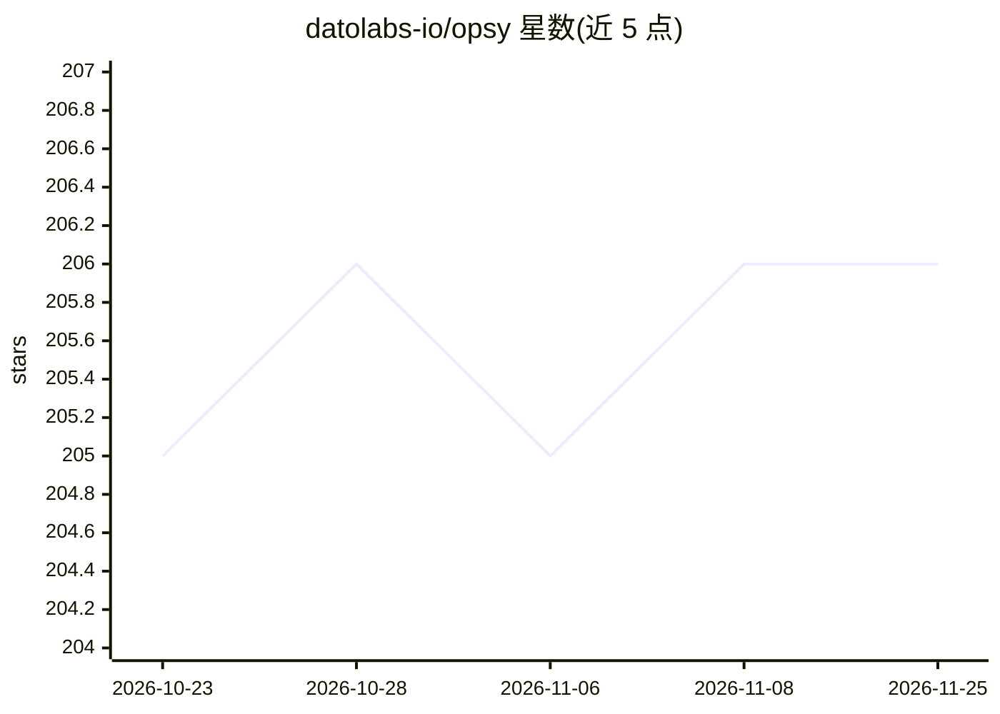

# datolabs-io/opsy

⭐ 206 · Go · Apache-2.0 · 推送 2026-10-30 · [GitHub](https://github.com/datolabs-io/opsy) · 组织维护

**面向 SRE/DevOps 的 AI 命令行运维助手**

面向 SRE、DevOps 与平台工程师的命令行 AI 助手：用户以自然语言描述任务，Opsy 解析指令、制定计划并执行。采用 tools-as-agents 架构，每个工具（Kubernetes、Git、AWS 等）作为专门 agent，由主 agent 编排分解任务并委派。通过 Anthropic Claude 模型提供智能辅助，配合系统已安装的标准 CLI 工具工作，仅调用已安装的工具以适配环境。当前处于早期开发阶段，建议在非生产环境使用。

## 筛选速览

| 维度 | 判定 | 备注 |
|---|---|---|
| AI 角色 | `ai-native` | 本体是模型或模型工具 |
| 许可风险 | `permissive` | Apache-2.0 |
| 部署形态 | `library` | 以包/库形式分发 |
| 模型依赖 | locked-api |  |
| 硬件要求 | — | 无带数字的原话,不猜 |
| 安装摩擦 | `low` | 无编译、无系统依赖或容器化 |
| 成熟度 | `idea` | |

## 能力要点

- tools-as-agents 架构：每个工具作为领域专门 AI agent，主 agent 编排委派
- 自然语言描述任务，自动制定计划并执行
- 集成 Git、GitHub CLI、kubectl、AWS CLI、Helm、gcloud、Jira CLI 等标准工具
- 通过 assets/prompts 与 assets/tools/ YAML 定义可扩展工具与提示词

## 适用场景

- 分析失败 Pod 的原因并自动创建 Jira 工单
- 将部署清单提取并推送到备份仓库
- 以自然语言在 GitHub 组织中创建私有仓库
- Kubernetes/Git/AWS 日常运维流程自动化

## 场景标签

`AI 助手` · 领域:对话与助手

## 证据(README 行号)

> L6: Opsy is an intelligent command-line assistant designed for Site Reliability Engineers (SREs), DevOps professionals, 
> L8: Opsy uses a "tools-as-agents" architecture where each tool functions as a specialized AI agent with expertise in its
> L27: Opsy uses Anthropic's Claude AI models to provide intelligent assistance. You'll need an Anthropic API key:

## 星数曲线

2026-10-23 205 → 2026-11-25 206（+1）

---
*卡片 v1 · prompt 1.4 · 生成 2026-11-25 · 置信度 high · 依据 README sha `a6209479aeab` · [字段定义](../../DATASET.md)*
