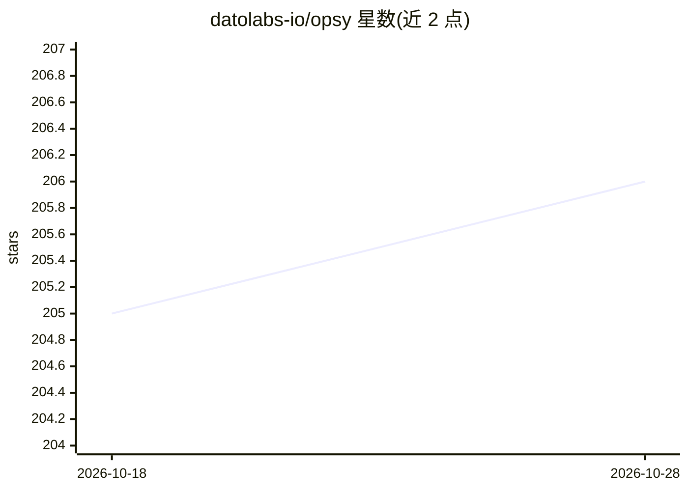

# datolabs-io/opsy

⭐ 206 · Go · Apache-2.0 · 推送 2026-04-20 · [GitHub](https://github.com/datolabs-io/opsy) · 组织维护

**面向 SRE/DevOps 的 AI 命令行运维助手**

用 Go 编写的命令行/TUI 助手，供 SRE、DevOps 与平台工程师用自然语言描述运维任务，由主 agent 按编排将任务拆解并委派给 Kubernetes、Git、GitHub、AWS、Helm、gcloud、Jira 等各领域的专用工具 agent 执行。依赖 Anthropic Claude 模型，需设置 ANTHROPIC_API_KEY；CLI 工具非强制安装，装了则扩展能力。README 声明处于早期开发阶段，建议先在非生产环境使用。提供 go install、Homebrew 与直接下载二进制三种安装方式。

## 筛选速览

| 维度 | 判定 | 备注 |
|---|---|---|
| AI 角色 | `ai-native` | 本体是模型或模型工具 |
| 许可风险 | `permissive` | Apache-2.0 |
| 部署形态 | `library` | 以包/库形式分发 |
| 模型依赖 | locked-api |  |
| 硬件要求 | — | 无带数字的原话,不猜 |
| 安装摩擦 | `low` | 无编译、无系统依赖或容器化 |
| 成熟度 | `idea` | |

## 能力要点

- tools-as-agents 架构：主 agent 编排各领域专用工具 agent
- 自然语言描述任务，自动生成计划并执行
- 按环境自适应，仅使用已安装的 CLI 工具
- YAML 配置文件与环境变量双通道配置，支持主题与提示词扩展

## 适用场景

- 用自然语言排查 Kubernetes 故障并自动建 Jira 任务
- 批量执行仓库管理、部署备份等日常运维操作
- 在终端里让 AI 代为操作 kubectl/Git/AWS 等命令行工具

## 场景标签

`工作流自动化` `AI 助手` · 领域:效率与自动化

## 证据(README 行号)

> L6: Opsy is an intelligent command-line assistant designed for Site Reliability Engineers (SREs), DevOps professionals, 
> L8: Opsy uses a "tools-as-agents" architecture where each tool functions as a specialized AI agent with expertise in its

## 星数曲线

2026-10-18 205 → 2026-10-28 206（+1）

---
*卡片 v1 · prompt 1.4 · 生成 2026-10-22 · 置信度 high · 依据 README sha `40189b0416e4` · [字段定义](../../DATASET.md)*
