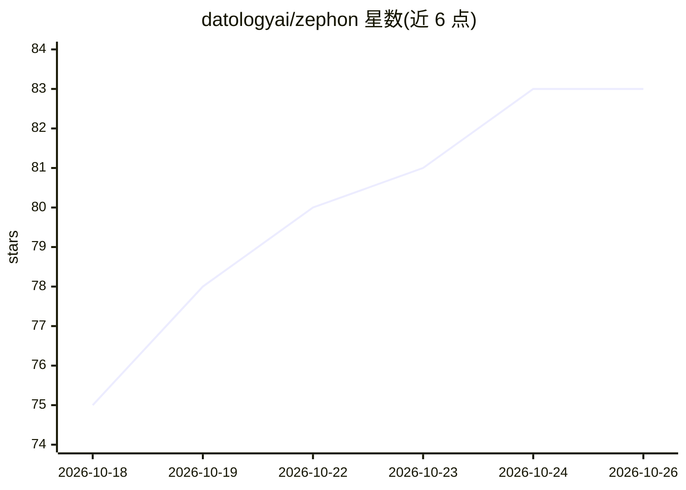

# datologyai/zephon

⭐ 83 · Python · Apache-2.0 · 推送 2026-10-23 · [GitHub](https://github.com/datologyai/zephon) · [官网](https://zephon.io) · 组织维护

**面向基础模型训练的弹性确定性数据加载库**

由 DatologyAI 开发的 Python 数据加载库，将训练内容（数据集、混合比例）与加载变换方式分离，支持在线 tokenization、序列打包、过滤与动态混合，无需离线预处理；通过 lane（canonical_replicas）机制保证在不同 GPU 数量下断点恢复后每个全局 batch 数据一致且可复现。以 PyPI 包提供，可选 extras 支持 S3/GCS/Azure、Hugging Face datasets、Parquet、MDS、LitData、Lance 等数据源，并维护 TorchTitan 与 Megatron-LM 参考集成。自述为 beta 软件，Ray runner 处于实验阶段。

## 筛选速览

| 维度 | 判定 | 备注 |
|---|---|---|
| AI 角色 | `ai-ecosystem` | LLM/agent 周边工具 |
| 许可风险 | `permissive` | Apache-2.0 |
| 部署形态 | `library` | 以包/库形式分发 |
| 模型依赖 | — | README 未给出锁定关系 |
| 硬件要求 | — | 无带数字的原话,不猜 |
| 安装摩擦 | `low` | 无编译、无系统依赖或容器化 |
| 成熟度 | `idea` | |

## 能力要点

- 在线处理（tokenization/打包/过滤/动态混合）替代离线预处理
- 弹性确定性：改变 GPU/并行度后恢复仍产出相同全局 batch
- Engine 将 Pipeline 编译为并发阶段，fetch/处理/训练重叠执行
- 多种 shard 格式与云存储后端的可选 extras

## 适用场景

- 基础模型预训练中替代 PyTorch DataLoader 做数据加载
- 数据集配比实验需要两次训练运行严格可对比
- 抢占式调度环境下在变动的 GPU 数量上断点恢复训练
- S3/HF/Parquet 等分布式 shard 数据的在线打包训练

## 场景标签

`模型训练` · 领域:训练与推理

## 证据(README 行号)

> L20: Zephon is a high-performance data loading library that separates **what** you train on
> L64: A Zephon pipeline has three parts: a `Dataset` that describes your data, a `WorkSource`
> L85: A `Pipeline` is a plain Python iterable, so it works with whatever training loop you

## 星数曲线

2026-10-18 75 → 2026-10-26 83（+8）

---
*卡片 v1 · prompt 1.4 · 生成 2026-10-24 · 置信度 high · 依据 README sha `b0b7877ea3c7` · [字段定义](../../DATASET.md)*
