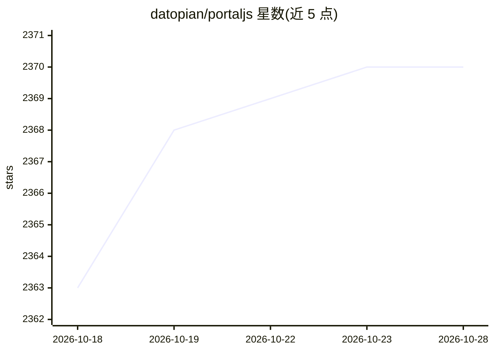

# datopian/portaljs

⭐ 2,370 · TypeScript · MIT · 推送 2026-10-28 · [GitHub](https://github.com/datopian/portaljs) · [官网](https://www.portaljs.com) · 组织维护

**AI 原生框架：用 agent 技能从需求简报搭建数据门户**

由 Datopian 维护的开源数据门户构建框架，MIT 许可。核心是一组 Claude Code slash 命令技能：/portaljs-architect 根据数据规模与治理需求推荐存储/目录/托管架构，/portaljs-new-portal 生成 Home、Catalog、Showcase 三个页面的普通 Next.js 代码（无锁定），另有添加数据集、图表、地图、DCAT 输出、CKAN 接入与整库迁移等十余个技能。通过 DataProvider 接缝支持 CKAN、GitHub、Frictionless 等后端；推荐路径为 git+R2+Parquet 配 DuckDB 的开放 lakehouse。也可不经 AI 直接用 npm create 或 tiged 使用纯模板，需 Node 22+。

## 筛选速览

| 维度 | 判定 | 备注 |
|---|---|---|
| AI 角色 | `ai-ecosystem` | LLM/agent 周边工具 |
| 许可风险 | `permissive` | MIT |
| 部署形态 | `library` | 以包/库形式分发 |
| 模型依赖 | locked-api |  |
| 硬件要求 | — | 无带数字的原话,不猜 |
| 安装摩擦 | `low` | 无编译、无系统依赖或容器化 |
| 成熟度 | — | 结构信号不足 |

## 能力要点

- Claude Code 技能把简报转为可编辑的 Next.js 门户（三页面结构）
- 十余个技能：添加数据集/图表/地图、DCAT 输出、CKAN 接入、整库迁移、部署
- DataProvider 接缝支持 CKAN、DKAN、DataHub、GitHub、Frictionless 等后端
- 可完全绕过 AI，用 npm create 或 tiged 直接脚手架纯模板

## 适用场景

- 数据团队从需求简报快速搭建开放数据门户
- 把现有 CKAN/ArcGIS/Socrata 目录迁移到独立门户
- 为数据集生成带图表、地图与 DCAT 元数据的展示页

## 场景标签

`代码生成` · 领域:编码与开发

## 证据(README 行号)

> L70: PortalJS is an **open-source, agentic skills framework that helps data teams build,
> L110: PortalJS ships Claude Code skills that turn a brief into

## 星数曲线

2026-10-18 2,363 → 2026-10-28 2,370（+7）

---
*卡片 v1 · prompt 1.4 · 生成 2026-10-21 · 置信度 high · 依据 README sha `10b2eb811691` · [字段定义](../../DATASET.md)*
