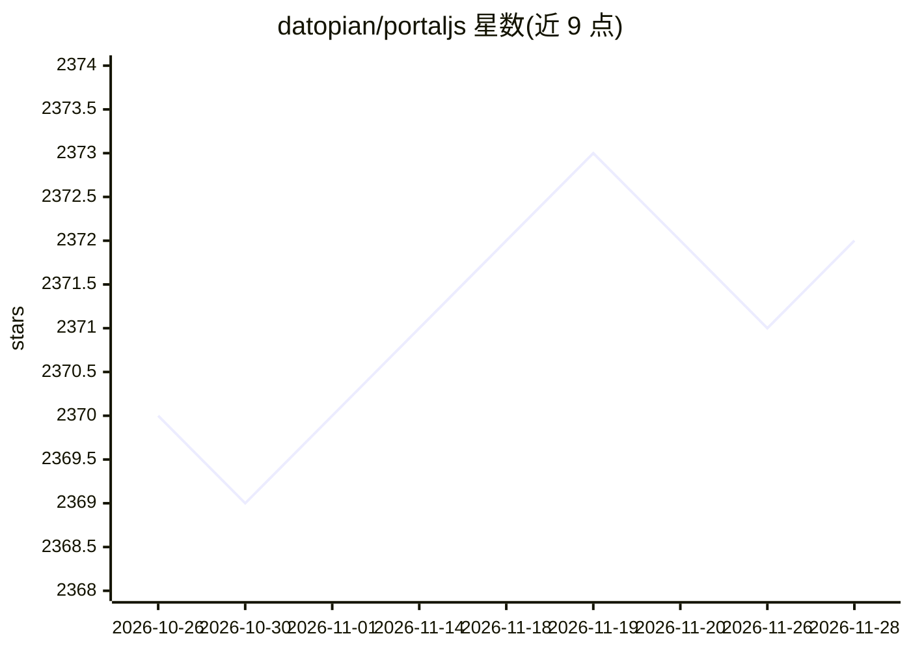

# datopian/portaljs

⭐ 2,372 · TypeScript · MIT · 推送 2026-10-28 · [GitHub](https://github.com/datopian/portaljs) · [官网](https://www.portaljs.com) · 组织维护

**AI 技能驱动的数据门户构建框架，从需求描述生成门户**

PortalJS 是构建数据门户的框架，提供 Home、目录搜索（/search）与数据集展示页三个页面。核心机制是一组 Claude Code 斜杠命令技能：/portaljs-architect 根据数据规模与治理需求推荐架构，/portaljs-new-portal 脚手架生成 Next.js 代码，另有加载 CSV/GeoJSON 数据、生成 DCAT feed、连接 CKAN 后端、迁移既有目录、部署到 Cloudflare 等十余个技能。模板为纯 Next.js 代码无锁定，也可完全不经 AI 手动构建。需 Node 22+。

## 筛选速览

| 维度 | 判定 | 备注 |
|---|---|---|
| AI 角色 | `ai-native` | 本体是模型或模型工具 |
| 许可风险 | `permissive` | MIT |
| 部署形态 | `library` | 以包/库形式分发 |
| 模型依赖 | locked-api |  |
| 硬件要求 | — | 无带数字的原话,不猜 |
| 安装摩擦 | `low` | 无编译、无系统依赖或容器化 |
| 成熟度 | — | 结构信号不足 |

## 能力要点

- 13 个 Claude Code 技能覆盖架构建议、脚手架、数据加载、迁移与部署
- 通过 DataProvider 接口解耦数据源（CKAN/DKAN/DataHub/GitHub/静态文件）
- /portaljs-add-dcat 输出 DCAT 2/3、DCAT-AP 等标准 feed 供开放数据门户收割
- 推荐 git + Cloudflare R2 + Parquet + DuckDB 的 open lakehouse 路径

## 适用场景

- 为政府或机构搭建开放数据发布门户
- 把现有 CKAN/Socrata/ArcGIS 目录迁移到静态门户
- 给 CSV/GeoJSON 数据集自动生成带图表和地图的展示页

## 场景标签

`代码生成` · 领域:编码与开发

## 证据(README 行号)

> L4:  The AI-native framework for building data portals.
> L33: **Build it with your AI assistant** — PortalJS ships Claude Code
> L70: PortalJS is an **open-source, agentic skills framework that helps data teams build,

## 星数曲线

2026-10-26 2,370 → 2026-11-28 2,372（+2）

---
*卡片 v1 · prompt 1.4 · 生成 2026-11-23 · 置信度 high · 依据 README sha `cffb7762c511` · [字段定义](../../DATASET.md)*
