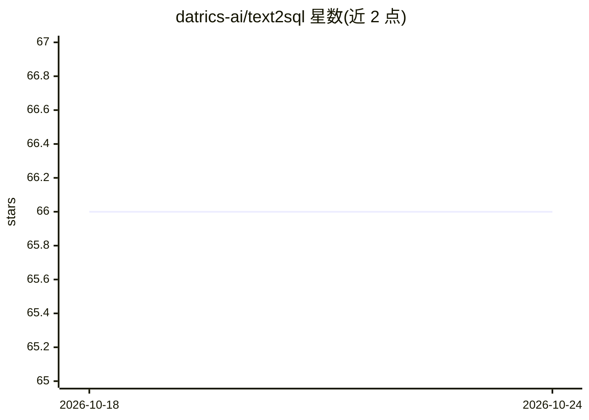

# datrics-ai/text2sql

⭐ 66 · Python · Apache-2.0 · 推送 2026-05-01 · [GitHub](https://github.com/datrics-ai/text2sql) · [官网](https://datrics.ai) · 组织维护

**自然语言转 SQL 的 Text2SQL 引擎，带 RAG 语义层**

Datrics 开源的自然语言到 SQL 转换引擎：通过语义层读取数据库文档与示例抽取概念，用相似示例的检索与重排在未见表上生成查询，并可根据连接的数据库自动生成文档。向量存储使用 chromadb，嵌入依赖 OpenAI Embeddings，LLM 通过 litellm 配置接入。以 Python 包安装、Streamlit 应用方式运行，Docker 用于本地测试数据库；README 注明对其他 LLM 与向量库的支持尚未提供。

## 筛选速览

| 维度 | 判定 | 备注 |
|---|---|---|
| AI 角色 | `ai-native` | 本体是模型或模型工具 |
| 许可风险 | `permissive` | Apache-2.0 |
| 部署形态 | `self-host` | docker 或自建部署 |
| 模型依赖 | — | README 未给出锁定关系 |
| 硬件要求 | — | 无带数字的原话,不猜 |
| 安装摩擦 | `low` | 无编译、无系统依赖或容器化 |
| 成熟度 | `idea` | |

## 能力要点

- 基于数据库文档与示例构建语义层
- 相似示例检索与重排用于未见表的查询生成
- 连接数据库后自动生成文档与 schema 索引
- LLM 通过 litellm 配置接入，向量存储用 chromadb

## 适用场景

- 用自然语言查询自己的数据库并生成 SQL
- 自动为数据库生成结构文档与语义层
- 在已有 LLM 上定制 Text-to-SQL 能力

## 场景标签

`数据分析` `RAG` · 领域:效率与自动化

## 证据(README 行号)

> L3: Datrics Text-to-SQL engine designed to understand databases effortlessly, turning plain English into accurate SQL qu
> L10: 1. Semantic Layer:
> L51: streamlit run main.py

## 星数曲线

2026-10-18 66 → 2026-10-24 66（+0）

---
*卡片 v1 · prompt 1.4 · 生成 2026-10-24 · 置信度 high · 依据 README sha `1bd5f49f528e` · [字段定义](../../DATASET.md)*
