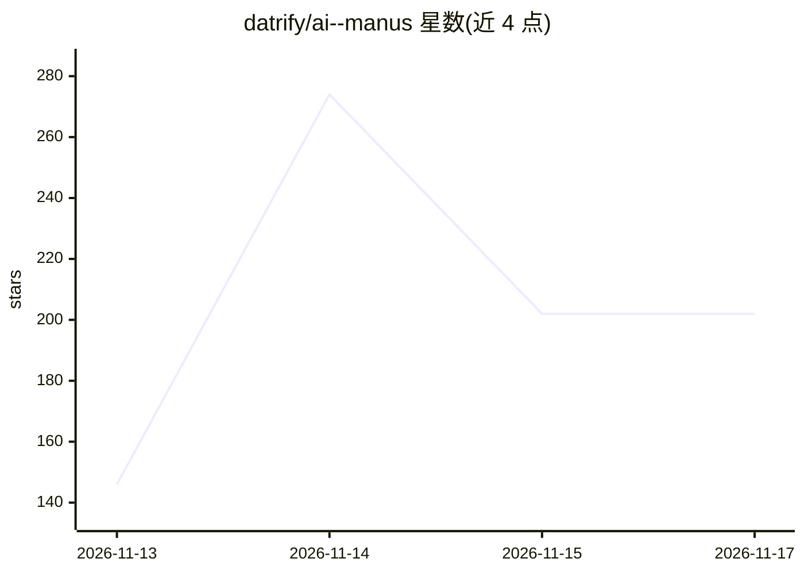

# datrify/ai--manus

⭐ 202 · Apache-2.0 · 推送 2026-11-14 · [GitHub](https://github.com/datrify/ai--manus) · 个人维护

**面向日常小任务的自主 AI Agent：自动写码执行与浏览器操控**

自称 Manus 的自主 AI Agent 系统，在沙箱环境中运行工具：可自行编写并执行脚本、控制浏览器完成导航/填表/信息收集，并执行多步骤任务，定位为家庭、学习与轻量办公场景的后台个人助手，强调非开发者也可使用。README 给出硬件兼容表（最低双核 CPU/4GB 内存）与六步上手流程（配置/测试/维护）。全文为营销式描述，未提供任何安装命令、代码仓库结构或模型接入说明，实际可用性无法从 README 验证。

## 筛选速览

| 维度 | 判定 | 备注 |
|---|---|---|
| AI 角色 | `ai-native` | 本体是模型或模型工具 |
| 许可风险 | `permissive` | Apache-2.0 |
| 部署形态 | `None` |  |
| 模型依赖 | — | README 未给出锁定关系 |
| 硬件要求 | — | 无带数字的原话,不猜 |
| 安装摩擦 | `low` | 无编译、无系统依赖或容器化 |
| 成熟度 | — | 结构信号不足 |

## 能力要点

- 自主编写并执行代码完成任务
- 浏览器控制：导航网页、填表、收集信息
- 代码与浏览器动作可在同一工作流中衔接
- 面向家庭/学习/轻量办公的小规模任务设计

## 适用场景

- 让学生整理研究笔记、跑小脚本
- 让 agent 代为完成网页查资料、填表等重复操作
- 远程工作者从多个页面汇总信息准备小结

## 场景标签

`AI 助手` `浏览器自动化` `编码 Agent` `工作流自动化` · 领域:效率与自动化

## 证据(README 行号)

> L10: - **Autonomous Code Execution:** Manus AI agent runs code on its own to complete tasks, so you can focus on decisio
> L18: Manus is an autonomous AI agent designed to run code and control a browser on your behalf. Instead of acting like a

## 星数曲线

2026-11-13 146 → 2026-11-17 202（+56）

---
*卡片 v1 · prompt 1.4 · 生成 2026-11-17 · 置信度 mid · 依据 README sha `4347b4dd3fa7` · [字段定义](../../DATASET.md)*
