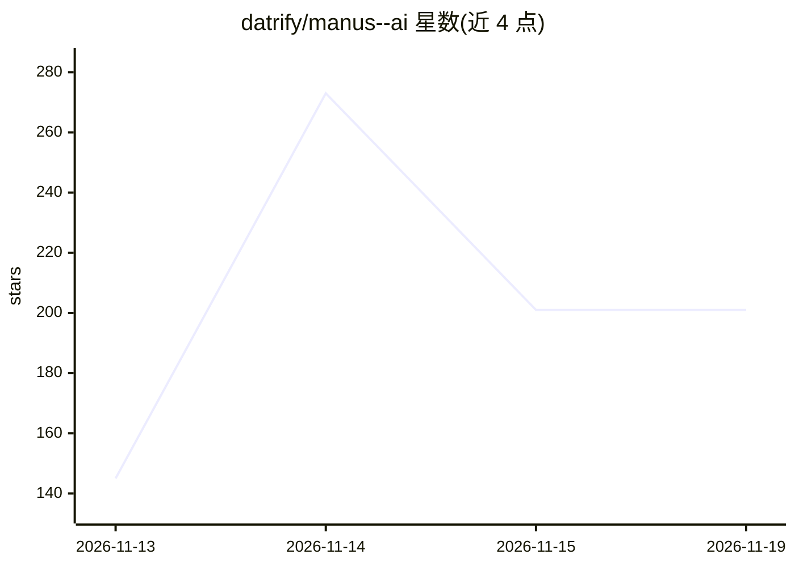

# datrify/manus--ai

⭐ — · [GitHub]() · 个人维护

**面向日常任务的自主 AI Agent，可执行代码与控制浏览器**

README 描述 Manus 为自主 AI Agent：代替用户编写并执行脚本、控制浏览器（导航网页、填写表单、采集信息）、执行多步骤任务，可在后台作为个人助手运行。定位为家庭、学习与轻量工作场景的辅助工具，非企业平台。文档给出操作系统/CPU/内存等兼容性要求与六步上手流程，但未提供安装命令、源码结构或模型接入细节，实际实现方式不可从 README 验证。

## 筛选速览

| 维度 | 判定 | 备注 |
|---|---|---|
| AI 角色 | `ai-native` | 本体是模型或模型工具 |
| 许可风险 | `permissive` | — |
| 部署形态 | `None` |  |
| 模型依赖 | — | README 未给出锁定关系 |
| 硬件要求 | — | 无带数字的原话,不猜 |
| 安装摩擦 | `low` | 无编译、无系统依赖或容器化 |
| 成熟度 | — | 结构信号不足 |

## 能力要点

- 自主编写并执行代码完成多步骤任务
- 浏览器控制：导航网页、填写表单、采集信息
- 后台个人助手模式，跨会话保持任务模式

## 适用场景

- 让学生组织研究资料并运行小型脚本
- 远程工作者从多个网页采集数据
- 将重复性的代码与浏览器操作交给代理执行

## 场景标签

`AI 助手` `编码 Agent` `浏览器自动化` · 领域:效率与自动化

## 证据(README 行号)

> L10: - **Autonomous Code Execution:** Manus AI agent runs code on its own to complete tasks, so you can focus on decisio
> L18: Manus is an autonomous AI agent designed to run code and control a browser on your behalf. Instead of acting like a

## 星数曲线

2026-11-13 145 → 2026-11-19 201（+56）

---
*卡片 v1 · prompt 1.4 · 生成 2026-11-17 · 置信度 mid · 依据 README sha `885ad01e4b6b` · [字段定义](../../DATASET.md)*
