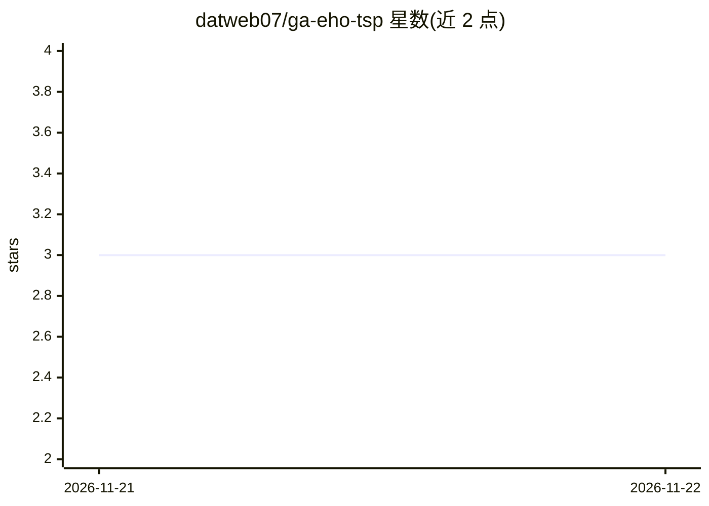

# datweb07/ga-eho-tsp

⭐ 3 · Jupyter Notebook · NOASSERTION · 推送 2026-11-21 · [GitHub](https://github.com/datweb07/ga-eho-tsp) · 个人维护 · 中文 README

**用遗传算法与象群优化求解 TSP 的课程实验项目**

大学人工智能课程项目，实现遗传算法（GA）与象群优化（EHO）两种元启发式算法求解旅行商问题，提供 Tkinter+Matplotlib 图形界面、CLI 与 Jupyter 实验笔记本。GA 已可端到端运行：支持选择交叉/初始化方法、评估次数预算、固定 seed 复现，并输出 JSON/CSV/PNG 结果；EHO 核心尚在开发，未接入 GUI 与 CLI。运行需 Python 3.11+，依赖 NumPy/Matplotlib/Tkinter。

## 筛选速览

| 维度 | 判定 | 备注 |
|---|---|---|
| AI 角色 | `ai-native` | 本体是模型或模型工具 |
| 许可风险 | `none` | NOASSERTION |
| 部署形态 | `desktop` | 安装包/桌面程序 |
| 模型依赖 | — | README 未给出锁定关系 |
| 硬件要求 | — | 无带数字的原话,不猜 |
| 安装摩擦 | `low` | 无编译、无系统依赖或容器化 |
| 成熟度 | `idea` | |

## 能力要点

- GA 求解 TSP，支持 PMX 交叉与 mixed 初始化等参数配置
- 固定 seed 可复现同一 route、distance 与收敛历史
- 7 个基准矩阵 × 多 seed 的 benchmark 批量评测，输出 CSV/JSON/summary
- GUI 可视化路线、收敛曲线与运行明细，运行中可中止并返回当前最优

## 适用场景

- 教学场景下演示和对比元启发式算法求解 TSP
- 在基准矩阵上跑批量实验并导出收敛数据做分析
- 交互式可视化 TSP 求解过程与结果路线

## 场景标签

 · 领域:算法研究/优化

## 证据(README 行号)

> L7: This repository contains a university Artificial Intelligence course project focused on solving the **Traveling Sale
> L12: The project aims to implement, visualize, and experimentally evaluate both algorithms across different TSP instance
> L67: python -m ga_eho_tsp.cli solve --algorithm ga --dataset data/15Cities-1194.txt --seed 42 --json outputs/ga.json

## 星数曲线

2026-11-21 3 → 2026-11-22 3（+0）

---
*卡片 v1 · prompt 1.4 · 生成 2026-11-22 · 置信度 high · 依据 README sha `a8a53a24cfe7` · [字段定义](../../DATASET.md)*
