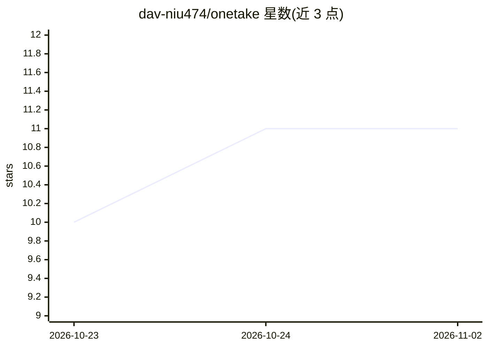

# dav-niu474/onetake

⭐ 11 · TypeScript · 推送 2026-08-30 · [GitHub](https://github.com/dav-niu474/onetake) · [官网](https://github.com/dav-niu474/agent-video-canvas#readme) · 个人维护 · 中文 README

**节点式 AI 视频创作画布：从提示词到成片的全链路可视化生成**

基于 Next.js 16 + React Flow 的节点式 AI 视频创作平台：用户在画布上拖拽 14 种节点并连线，串联提示词扩写（LLM）、CogView 文生图/图生图、文生视频/图生视频、TTS 配音等生成节点，再经服务端 ffmpeg 完成混流、拼接与转场合成成片。支持按能力维度接入 OpenAI 兼容的自有模型服务，未配置时回落内置智谱；提供拓扑分层并行执行、429 退避重试、断线恢复与全链路持久化。本地运行需 bun 与系统安装 ffmpeg/ffprobe，视频任务为云端异步生成（单段约 1-5 分钟）。面向内容创作者，内置 12 个场景模板。

## 筛选速览

| 维度 | 判定 | 备注 |
|---|---|---|
| AI 角色 | `ai-native` | 本体是模型或模型工具 |
| 许可风险 | `none` | — |
| 部署形态 | `None` |  |
| 模型依赖 | — | README 未给出锁定关系 |
| 硬件要求 | — | 无带数字的原话,不猜 |
| 安装摩擦 | `medium` | 含编译或系统依赖之一 |
| 成熟度 | — | 结构信号不足 |

## 能力要点

- 14 种节点覆盖输入→AI 生成→编辑处理→输出，类型化端口实时校验
- 真实 AI 执行管线：LLM 提示词扩写、文生图、文/图生视频、TTS 配音
- 服务端 ffmpeg 成片合成与视频拼接（5 种转场）
- 多供应商模型配置（OpenAI 兼容协议），密钥本机存储与脱敏回显

## 适用场景

- 在一张画布上从文案到成片完成短剧/MV/宣传片创作
- 用内置模板一键载入完整创作链路快速出片
- 接入自有 OpenAI 兼容模型服务，数据与密钥留在本机

## 场景标签

`视频生成` `图像生成` `语音合成` · 领域:内容生成

## 证据(README 行号)

> L8: **Node-based AI video creation canvas** — drag nodes, wire pipelines, and produce real AI-generated videos: prompt e
> L25: - **🤖 真实 AI 执行管线**（非模拟）：

## 星数曲线

2026-10-23 10 → 2026-11-02 11（+1）

---
*卡片 v1 · prompt 1.4 · 生成 2026-11-02 · 置信度 high · 依据 README sha `8423ad5b1773` · [字段定义](../../DATASET.md)*
