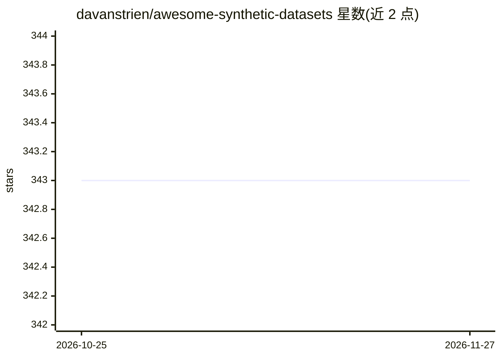

# davanstrien/awesome-synthetic-datasets

⭐ 343 · Jupyter Notebook · CC-BY-SA-4.0 · 推送 2026-11-04 · [GitHub](https://github.com/davanstrien/awesome-synthetic-datasets) · 个人维护

**面向想构建合成数据集的人的教程、数据集与工具清单**

以 awesome 清单形式组织 LLM 合成数据（文本/视觉）相关资源，按教程与博客、重要技术、重要数据集、库与工具、重要论文分类收录。数据集部分收录 TinyStories、Cosmopedia、WebSight 等条目并附摘要；工具部分收录 distilabel、DataDreamer、NeMo Data Designer 等生成框架；论文部分聚焦提出重要技术的代表作，另维护 Hugging Face 上的更长论文合集。维护者说明清单不求穷尽，以实用资源为主。

## 筛选速览

| 维度 | 判定 | 备注 |
|---|---|---|
| AI 角色 | `ai-knowledge` | 知识聚合/清单类 |
| 许可风险 | `viral` | CC-BY-SA-4.0 |
| 部署形态 | `None` |  |
| 模型依赖 | — | README 未给出锁定关系 |
| 硬件要求 | — | 无带数字的原话,不猜 |
| 安装摩擦 | `low` | 无编译、无系统依赖或容器化 |
| 成熟度 | — | 结构信号不足 |

## 能力要点

- 按教程/技术/数据集/工具/论文五类组织合成数据资源
- 收录 TinyStories、OpenHermes-2.5、Cosmopedia、WebSight 等数据集条目
- 收录 distilabel、DataDreamer、NeMo Data Designer 等生成框架
- 提供 Hugging Face 上的扩充论文合集

## 适用场景

- 开始构建自己的 LLM 合成训练数据集时查找入门教程
- 为指令微调挑选公开合成数据集（如 SQL、函数调用类）
- 调研合成数据生成技术与代表性论文

## 场景标签

`精选清单` `教程课程` · 领域:学习与行业

## 证据(README 行号)

> L9: ## Resources
> L13: ## Tutorials, guides and educational blog posts
> L112: ### Important Papers

## 星数曲线

2026-10-25 343 → 2026-11-27 343（+0）

---
*卡片 v1 · prompt 1.4 · 生成 2026-11-25 · 置信度 high · 依据 README sha `9c88f5c81892` · [字段定义](../../DATASET.md)*
