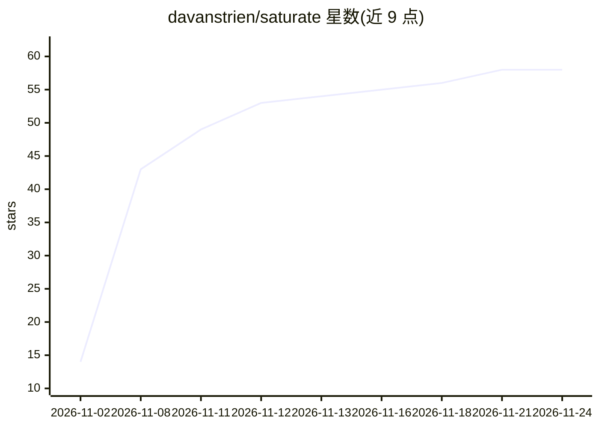

# davanstrien/saturate

⭐ 58 · Python · Apache-2.0 · 推送 2026-11-19 · [GitHub](https://github.com/davanstrien/saturate) · 个人维护

**数据集批量推理工具：行输入、任意 OpenAI 兼容端点、可恢复 parquet 输出**

Python 库 saturate：把数据集每行（或存储桶每文件）送入任意 OpenAI 兼容端点做 OCR、嵌入、分类、翻译、合成等推理，输出可恢复的 append-only parquet（或逐行文件 sink）。核心机制是拥塞感知的自适应并发窗口，用户不需选择并发数；支持 kill 后重跑、精确续跑、失败行为持久 error row。面向控制自有推理端点（vLLM/SGLang/TEI 等）的开发者。API 处于 0.x 实验期，需锁定版本；不支持 agent 多轮循环与按配额调度。

## 筛选速览

| 维度 | 判定 | 备注 |
|---|---|---|
| AI 角色 | `ai-ecosystem` | LLM/agent 周边工具 |
| 许可风险 | `permissive` | Apache-2.0 |
| 部署形态 | `library` | 以包/库形式分发 |
| 模型依赖 | local-ok | 支持本地模型 |
| 硬件要求 | — | 无带数字的原话,不猜 |
| 安装摩擦 | `medium` | 含编译或系统依赖之一 |
| 成熟度 | `idea` | |

## 能力要点

- 拥塞感知自适应并发窗口，无需手动选并发数
- crash-safe 的 append-only parquet 输出与精确 resume
- 任意 OpenAI 兼容端点（vLLM/SGLang/TEI/llama.cpp/TGI 等）
- 可组合的 pump() 四阶段分层与自定 IO sink 契约

## 适用场景

- 把百万级文本批量送入自建推理端点做嵌入或分类
- 对整库扫描页做 OCR 并输出可发布的数据集
- 在 HF Jobs 上跑单 GPU 的端到端批量推理脚本

## 场景标签

 · 领域:LLM 基础设施/数据处理

## 证据(README 行号)

> L8: You point it at an endpoint you control — a vLLM server you just started, a SGLang Job,
> L10: request, one that turns a response into output columns. It handles everything between:
> L41: `pump()` is a plain blocking call. Already have a server running? Skip `Engine` and pass its URL:

## 星数曲线

2026-11-02 14 → 2026-11-24 58（+44）

---
*卡片 v1 · prompt 1.4 · 生成 2026-11-18 · 置信度 high · 依据 README sha `2feeb808f867` · [字段定义](../../DATASET.md)*
