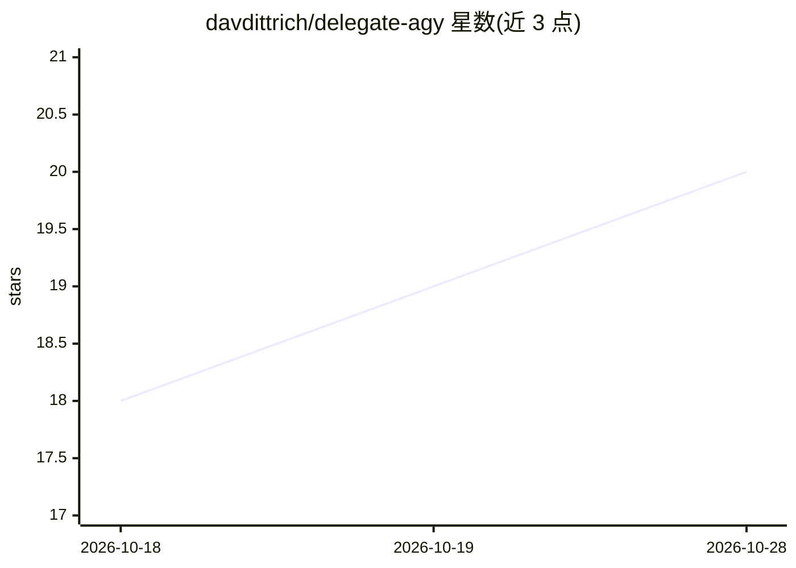

# davdittrich/delegate-agy

⭐ 20 · Shell · 推送 2026-08-23 · [GitHub](https://github.com/davdittrich/delegate-agy) · 个人维护

**让 Claude Code 会话接入 Gemini 与联网搜索的插件桥**

Claude Code 插件，由两部分组成：agy-bridge 脚本包装 Google Antigravity CLI（agy），按 --type（search/code/analysis/review/implement）路由到对应 Gemini 模型并施加工具限制与沙箱约束；agy-delegate 技能告诉 Claude 何时调用该桥（如联网搜索带引用、第二模型评审）。另含兼容 gemini 命令的 shim，供依赖 Gemini CLI 的框架在停服后继续工作。要求已安装并 OAuth 认证的 agy 与 python3，可选 coreutils。

## 筛选速览

| 维度 | 判定 | 备注 |
|---|---|---|
| AI 角色 | `ai-ecosystem` | LLM/agent 周边工具 |
| 许可风险 | `none` | — |
| 部署形态 | `None` |  |
| 模型依赖 | — | README 未给出锁定关系 |
| 硬件要求 | — | 无带数字的原话,不猜 |
| 安装摩擦 | `low` | 无编译、无系统依赖或容器化 |
| 成熟度 | — | 结构信号不足 |

## 能力要点

- --type 五类任务路由，运行时从 agy models 解析最新 Gemini 模型 id
- gemini 名称的 drop-in shim，为依赖 Gemini CLI 的框架提供迁移路径
- 每次调用写入 0600 GEMINI.md，提示词不出现于 ps/proc cmdline
- SubagentStart 建议性 hook 默认关闭，默认安装完全不生效

## 适用场景

- 在 Claude 会话中获取带来源引用的联网搜索
- 让 Gemini 作为第二模型做代码评审
- 在 Gemini CLI 停服后继续使用依赖 gemini 命令的框架

## 场景标签

`代码审查` · 领域:编码与开发

## 证据(README 行号)

> L1: A Claude Code plugin that routes tasks to agy (Google Antigravity CLI), giving your Claude sessions access to Gemini
> L13: The plugin has two parts.
> L17: **`agy-delegate`** is a Claude Code skill that tells Claude when to reach for the bridge. It triggers on phrases li

## 星数曲线

2026-10-18 18 → 2026-10-28 20（+2）

---
*卡片 v1 · prompt 1.4 · 生成 2026-10-28 · 置信度 high · 依据 README sha `a70e79f2102a` · [字段定义](../../DATASET.md)*
