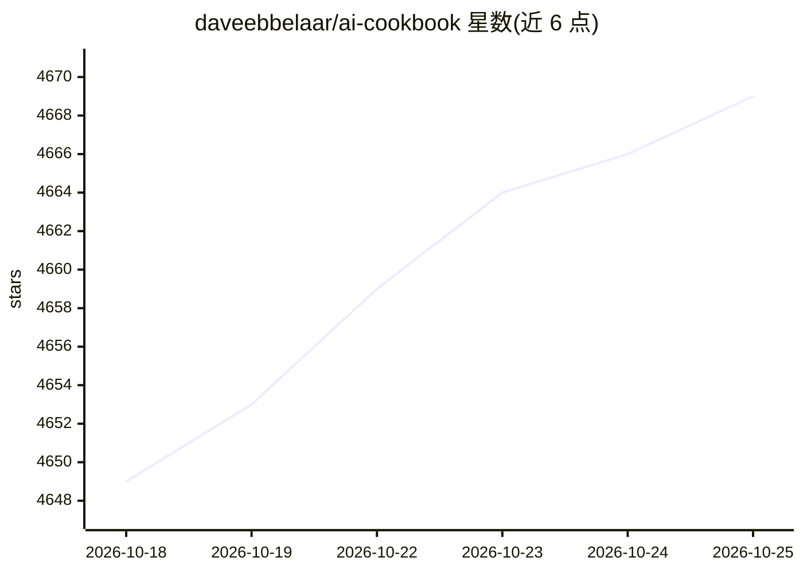

# daveebbelaar/ai-cookbook

⭐ 4,669 · Python · MIT · 推送 2026-09-21 · [GitHub](https://github.com/daveebbelaar/ai-cookbook) · [官网](https://www.youtube.com/@daveebbelaar) · 个人维护

**帮助开发者构建 AI 系统的示例与教程代码集**

由 Dave Ebbelaar（AI 工程师、Datalumina 创始人）维护的代码示例与教程合集（cookbook），面向开发者，提供可直接复制粘贴到自有项目的代码片段，用于构建 AI 系统。作者同时运营 YouTube 教程频道，并在 README 中关联其入门课程、GenAI 进阶项目指导与独立开发者咨询等其他资源。README 未列出具体目录结构、安装命令或依赖说明。

## 筛选速览

| 维度 | 判定 | 备注 |
|---|---|---|
| AI 角色 | `ai-knowledge` | 知识聚合/清单类 |
| 许可风险 | `permissive` | MIT |
| 部署形态 | `None` |  |
| 模型依赖 | — | README 未给出锁定关系 |
| 硬件要求 | — | 无带数字的原话,不猜 |
| 安装摩擦 | `low` | 无编译、无系统依赖或容器化 |
| 成熟度 | — | 结构信号不足 |

## 能力要点

- 提供可复制粘贴、可集成到自有项目的代码示例
- 覆盖 agents、LLM 等主题的教程合集
- 作者配套 YouTube 教程频道与进阶学习资源

## 适用场景

- 开发者查找 AI 系统构建的参考代码片段
- 跟随教程学习 agent 与 LLM 应用开发

## 场景标签

`教程课程` · 领域:学习与行业

## 证据(README 行号)

> L1: # Introduction
> L3: This Cookbook contains examples and tutorials to help developers build AI systems with copy/paste code snippets that

## 星数曲线

2026-10-18 4,649 → 2026-10-25 4,669（+20）

---
*卡片 v1 · prompt 1.4 · 生成 2026-10-20 · 置信度 high · 依据 README sha `836f401af234` · [字段定义](../../DATASET.md)*
