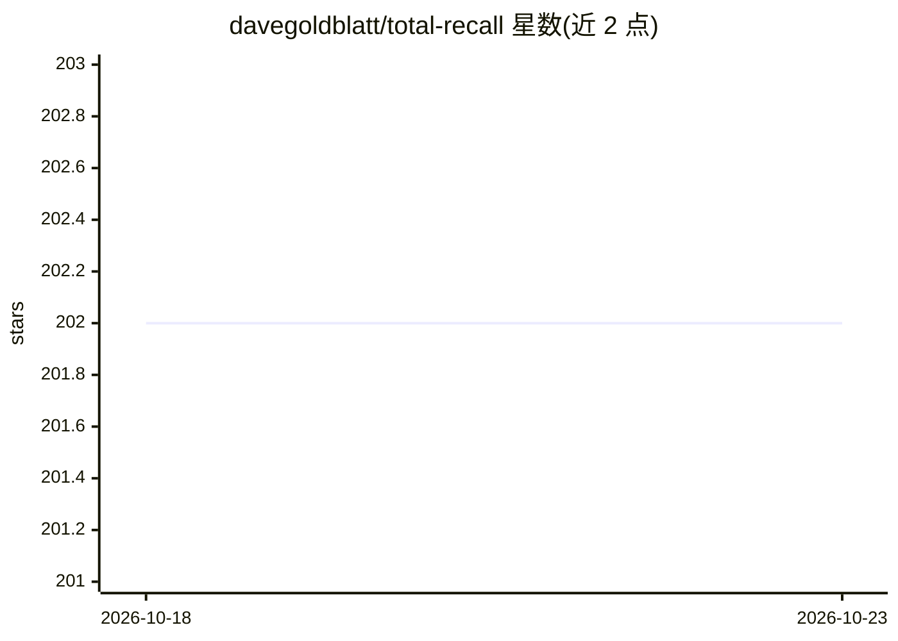

# davegoldblatt/total-recall

⭐ 202 · Shell · 推送 2026-02-12 · [GitHub](https://github.com/davegoldblatt/total-recall) · 个人维护

**给 Claude Code 的持久记忆插件：分层存储与写入门控**

Claude Code 的记忆插件，解决会话间遗忘问题。采用四层存储：Counter（CLAUDE.local.md，每会话自动加载约一页）、Pantry（按类别组织的 registers）、每日日志（所有写入先落此处）、归档。核心机制为写入门控：仅行为改变类事实、承诺、决策、稳定事实或用户明确要求记住的内容可通过，晋升为永久记忆由用户经 /recall-promote 显式控制。纠正内容会同步更新所有层级并标记旧条目为 superseded。全部本地 markdown 文件，无网络调用。提供插件市场安装与 install.sh 独立安装两种方式。

## 筛选速览

| 维度 | 判定 | 备注 |
|---|---|---|
| AI 角色 | `ai-ecosystem` | LLM/agent 周边工具 |
| 许可风险 | `none` | — |
| 部署形态 | `None` |  |
| 模型依赖 | — | README 未给出锁定关系 |
| 硬件要求 | — | 无带数字的原话,不猜 |
| 安装摩擦 | `low` | 无编译、无系统依赖或容器化 |
| 成熟度 | — | 结构信号不足 |

## 能力要点

- 四层记忆存储（Counter/Pantry/每日日志/归档），自动加载内容仅限规则与 Counter
- 写入门控：五项检查过滤临时信息，晋升由用户显式执行
- 纠正一次性传播到全部层级，旧条目标记 superseded 保留变更痕迹
- 全部本地 markdown 文件，无网络调用、无遥测，默认 gitignore 个人记忆

## 适用场景

- 让 Claude Code 在多次会话间记住偏好、决策与项目事实
- 审查并显式挑选哪些临时笔记值得永久保留
- 纠正 Claude 后使修正同步到所有记忆层级

## 场景标签

`Agent 记忆` · 领域:Agent 开发

## 证据(README 行号)

> L3: A memory system for Claude Code that remembers what matters and forgets what doesn't.
> L26: **Counter** (`CLAUDE.local.md`): The stuff you reach for every day. Loads automatically, every session. Kept small 

## 星数曲线

2026-10-18 202 → 2026-10-23 202（+0）

---
*卡片 v1 · prompt 1.4 · 生成 2026-10-22 · 置信度 high · 依据 README sha `a8e5812cf065` · [字段定义](../../DATASET.md)*
