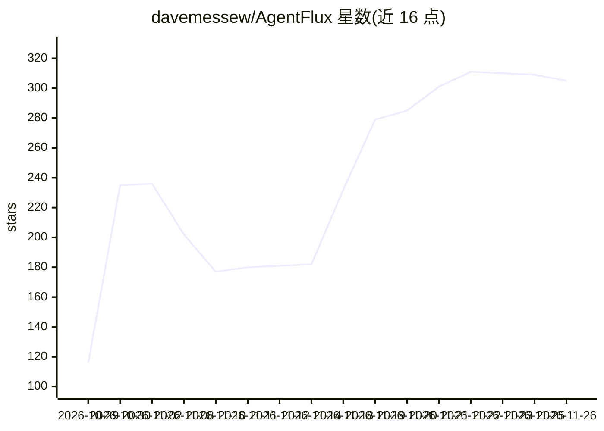

# davemessew/AgentFlux

⭐ 305 · TypeScript · Apache-2.0 · 推送 2026-10-30 · [GitHub](https://github.com/davemessew/AgentFlux) · [官网](https://agentflux.cloud) · 个人维护

**自托管的可视化工作流与自主 Agent 平台**

以浏览器界面运行的 Agentic AI 平台，将文档、数据源与语言模型连接到可视化工作流中：提供 17 个预配置步骤、八个模板、分支与 JSON 导入导出；可由 Agent 从任务描述生成工作流，也支持从屏幕录制视频生成工作流。数据、凭据与运行日志保存在本地 Docker 卷中。通过 Docker Compose 部署，无登录机制，面向单用户，公开访问需自行加访问控制层。

## 筛选速览

| 维度 | 判定 | 备注 |
|---|---|---|
| AI 角色 | `ai-ecosystem` | LLM/agent 周边工具 |
| 许可风险 | `permissive` | Apache-2.0 |
| 部署形态 | `desktop` | 安装包/桌面程序 |
| 模型依赖 | local-ok | 支持本地模型 |
| 硬件要求 | — | 无带数字的原话,不猜 |
| 安装摩擦 | `low` | 无编译、无系统依赖或容器化 |
| 成熟度 | — | 结构信号不足 |

## 能力要点

- 可视化工作流编辑器：17 个预配置步骤、八个模板、分支与撤销/重做
- 从视频（屏幕变化+语音讲解）自动生成并可运行工作流
- 连接 Ollama、LM Studio、vLLM 及 OpenAI 兼容端点的自有模型服务器
- 数据与运行日志存于本地卷，输出 JSON/CSV/Markdown 报告到本地目录

## 适用场景

- 在本地或自有服务器上搭建文档处理与自动化工作流
- 用 Agent 定时处理变化输入并生成结构化报告
- 基于本地模型构建知识库检索与文档问答流程
- 录制操作视频自动生成可复用的工作流

## 场景标签

`工作流自动化` `文档问答` · 领域:效率与自动化

## 证据(README 行号)

> L7: **Agentic AI platform** for visual workflows and autonomous agents.
> L20: AgentFlux connects documents, data sources and language models in a visual workflow. Build each step yourself or le
> L28: |**Your own models**|Connect Ollama, LM Studio, vLLM and OpenAI-compatible endpoints.|

## 星数曲线

2026-10-29 116 → 2026-11-26 305（+189）

---
*卡片 v1 · prompt 1.4 · 生成 2026-11-25 · 置信度 mid · 依据 README sha `2d47091a898b` · [字段定义](../../DATASET.md)*
