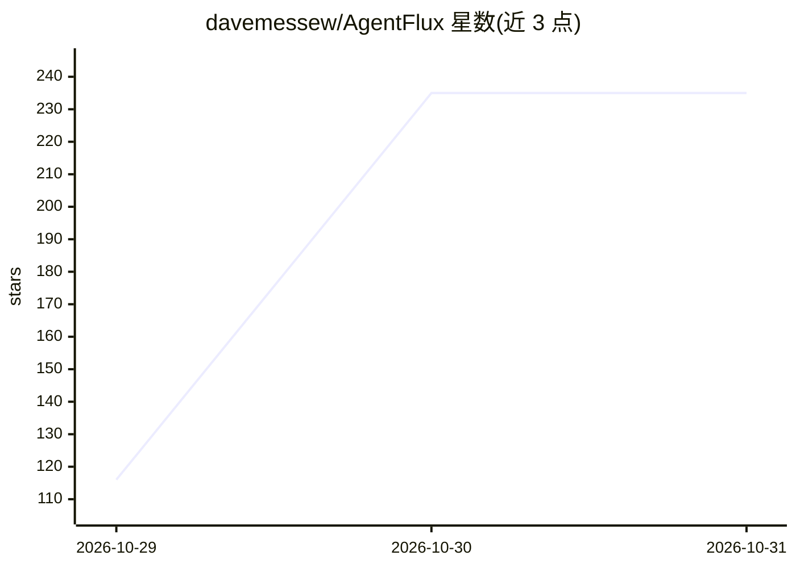

# davemessew/AgentFlux

⭐ 235 · TypeScript · Apache-2.0 · 推送 2026-10-30 · [GitHub](https://github.com/davemessew/AgentFlux) · [官网](https://agentflux.cloud) · 个人维护

**自托管的可视化工作流与自主 agent 平台，本地运行**

通过 Docker 自托管部署的 Agentic AI 平台，以浏览器界面提供可视化工作流编辑器（17 个预置步骤、8 个模板、分支与撤销重做）与自主 agent：描述任务、选择来源与模型即可执行或定时调度。支持从视频录制识别动作并生成可编辑工作流；文档与运行日志存储在本地命名卷中。模型接入 Ollama、LM Studio、vLLM 及 OpenAI 兼容端点，镜像本身不含模型。预构建镜像仅覆盖 Linux/amd64，无登录机制，面向单用户设计。

## 筛选速览

| 维度 | 判定 | 备注 |
|---|---|---|
| AI 角色 | `ai-ecosystem` | LLM/agent 周边工具 |
| 许可风险 | `permissive` | Apache-2.0 |
| 部署形态 | `desktop` | 安装包/桌面程序 |
| 模型依赖 | local-ok | 支持本地模型 |
| 硬件要求 | — | 无带数字的原话,不猜 |
| 安装摩擦 | `low` | 无编译、无系统依赖或容器化 |
| 成熟度 | — | 结构信号不足 |

## 能力要点

- 17 个预置步骤与 8 个模板的可视化工作流编辑器，支持 JSON 导入导出
- 从视频录制识别动作并生成可编辑工作流（需从源码构建）
- 接入 Ollama / LM Studio / vLLM / OpenAI 兼容端点
- 数据、凭据与运行日志保存在本地 Docker 命名卷

## 适用场景

- 在本机或服务器搭建私有 agent 与工作流自动化平台
- 导入 PDF/DOCX/CSV 等文件并连接自有模型做文档处理
- 把屏幕录制中的操作转换为可复用的工作流

## 场景标签

`工作流自动化` `Agent 框架` · 领域:Agent 开发

## 证据(README 行号)

> L7: **Agentic AI platform** for visual workflows and autonomous agents.
> L28: |**Your own models**|Connect Ollama, LM Studio, vLLM and OpenAI-compatible endpoints.|

## 星数曲线

2026-10-29 116 → 2026-10-31 235（+119）

---
*卡片 v1 · prompt 1.4 · 生成 2026-10-28 · 置信度 mid · 依据 README sha `9e1440c3fb8e` · [字段定义](../../DATASET.md)*
