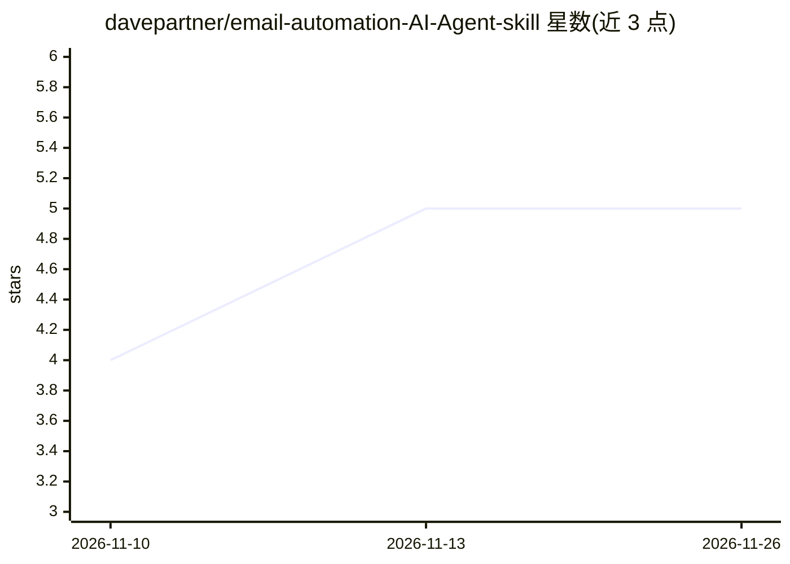

# davepartner/email-automation-AI-Agent-skill

⭐ 5 · MIT · 推送 2026-11-20 · [GitHub](https://github.com/davepartner/email-automation-AI-Agent-skill) · 个人维护

**让 AI agent 在应用管理后台搭建邮件自动化模块的技能**

一个供 Claude Code/Codex/Cursor 等 AI agent 消费的 SKILL.md 技能：一句话提示后，agent 会扫描目标应用的平台与后台，新增 Email Automation 菜单，装配 10 条生命周期序列（欢迎、弃购、售后、追加销售、召回、发薪日提醒、智能交叉销售等），附模板编辑、统计、用户退订控制与健康检查。默认以暂停状态交付，仅增量添加表与路由，不改动现有流程。调度核心附带可运行的测试代码，MIT 许可。

## 筛选速览

| 维度 | 判定 | 备注 |
|---|---|---|
| AI 角色 | `ai-knowledge` | 知识聚合/清单类 |
| 许可风险 | `permissive` | MIT |
| 部署形态 | `library` | 以包/库形式分发 |
| 模型依赖 | — | README 未给出锁定关系 |
| 硬件要求 | — | 无带数字的原话,不猜 |
| 安装摩擦 | `low` | 无编译、无系统依赖或容器化 |
| 成熟度 | — | 结构信号不足 |

## 能力要点

- 10 条生命周期邮件序列，含研究型漏斗时序（1h 弃购、24h 社会证明、48–72h 紧迫）
- 多渠道：email、push、WhatsApp、SMS，复用应用已有的 FCM/Twilio/WhatsApp Cloud API
- 默认暂停交付、全局开关、增量添加、可回滚的非破坏性保证
- 智能交叉销售：7 天冷却后按元数据→语义→协同过滤推荐下一个相似产品

## 适用场景

- 为电商应用生成弃购召回与生命周期邮件序列
- 让 AI agent 在现有后台里接入可审计的营销自动化模块
- 需要先审阅再启用、随时可停的邮件触达方案

## 场景标签

`工作流自动化` · 领域:效率与自动化

## 证据(README 行号)

> L15: > **This is an AI agent skill.** It builds a complete, non-disruptive **"Email Automation"** section
> L123: SKILL.md                              # the skill: workflow, sequences, non-negotiables

## 星数曲线

2026-11-10 4 → 2026-11-26 5（+1）

---
*卡片 v1 · prompt 1.4 · 生成 2026-11-21 · 置信度 mid · 依据 README sha `3cb7b99a1436` · [字段定义](../../DATASET.md)*
