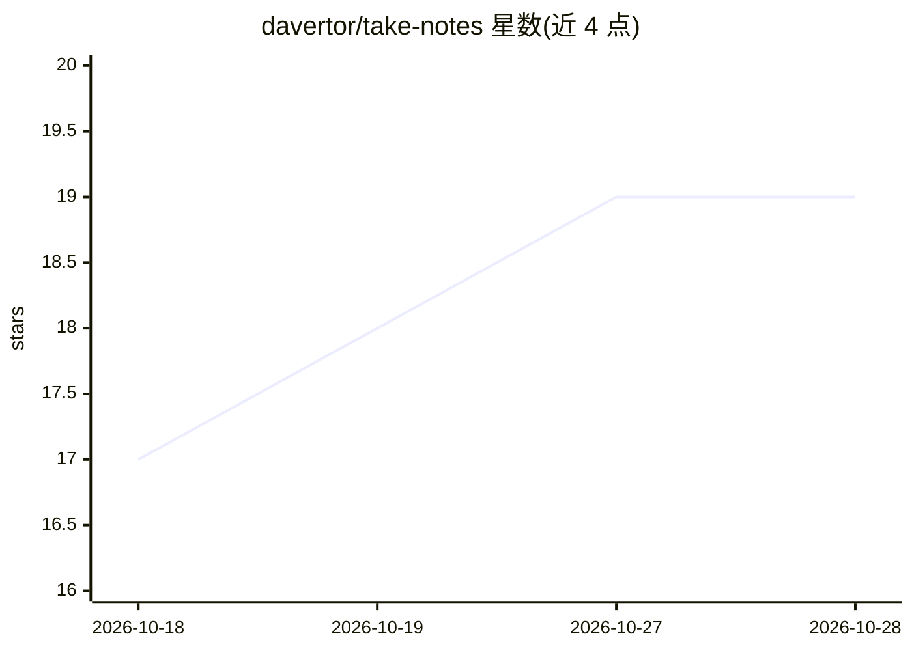

# davertor/take-notes

⭐ 19 · Python · MIT · 推送 2026-10-01 · [GitHub](https://github.com/davertor/take-notes) · 个人维护

**把视频/文章/论文/仓库转成教学式学习笔记的 Agent 技能**

一个面向 Claude Code、Codex、Cursor、OpenCode、Gemini CLI 等 Agent 宿主的技能（skill）：用户以 /take-notes 指向 YouTube 视频、网页文章、arXiv 论文、Google Slides 或 GitHub 仓库的 URL，宿主 agent 读取源内容并生成一份自包含 HTML 教学笔记（也支持 Markdown 与 Anki 导出），写入 ~/take-notes/ 形成本地可浏览归档。多源可合并为一份笔记，按源类型路由到不同体裁（offprint/fieldguide/recipe），支持主题、语言、focus 聚焦与封闭标签词表；仅在用户主动调用时运行。

## 筛选速览

| 维度 | 判定 | 备注 |
|---|---|---|
| AI 角色 | `ai-native` | 本体是模型或模型工具 |
| 许可风险 | `permissive` | MIT |
| 部署形态 | `library` | 以包/库形式分发 |
| 模型依赖 | — | README 未给出锁定关系 |
| 硬件要求 | — | 无带数字的原话,不猜 |
| 安装摩擦 | `medium` | 含编译或系统依赖之一 |
| 成熟度 | — | 结构信号不足 |

## 能力要点

- 支持 YouTube、网页文章、arXiv 论文、Google Slides、GitHub 仓库及本地媒体等来源
- 多源合并为单份笔记，首个 URL 决定主布局，来源可内联追溯
- 按源类型路由体裁（offprint/fieldguide/recipe），用户可自定义体裁与主题
- 输出自包含 HTML 归档于本地，并提供 Markdown 与 Anki 无损导出

## 适用场景

- 把长视频或长文转成可长期保有的结构化学习笔记
- 把一场讲座与其配套幻灯片合并成一份互相对照的笔记
- 用 Anki 导出把笔记内容转为记忆卡片

## 场景标签

`知识库管理` · 领域:知识与检索

## 证据(README 行号)

> L1: take·notes — turns a video, article, paper, or repo into didactic study notes, one self-contained HTML page you keep
> L54: /take-notes https://www.youtube.com/watch?v=NiKtZgImBdY
> L61: It writes `~/take-notes/html_reports/YYYY-MM-DD-<slug>.html` and opens it.

## 星数曲线

2026-10-18 17 → 2026-10-28 19（+2）

---
*卡片 v1 · prompt 1.4 · 生成 2026-10-28 · 置信度 low · 依据 README sha `3c87991d6311` · [字段定义](../../DATASET.md)*
