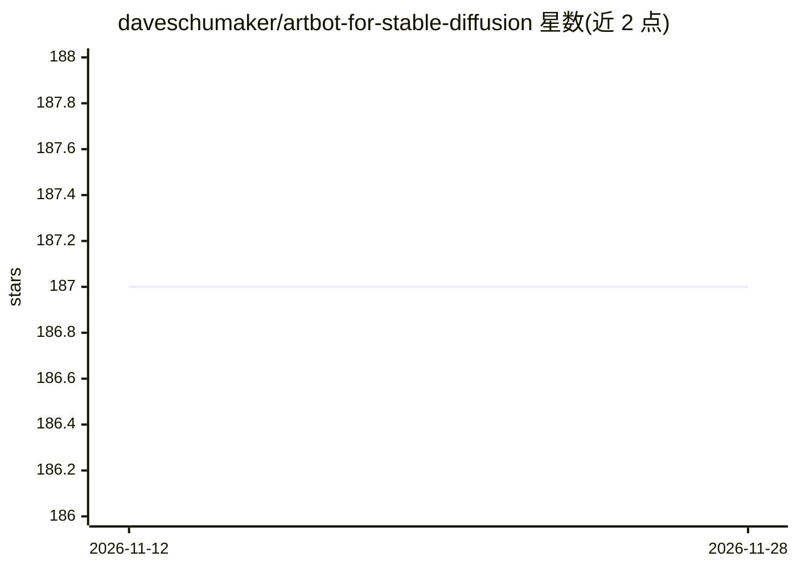

# daveschumaker/artbot-for-stable-diffusion

⭐ 187 · TypeScript · MIT · 推送 2026-11-17 · [GitHub](https://github.com/daveschumaker/artbot-for-stable-diffusion) · [官网](https://tinybots.net/artbot) · 个人维护

**与 AI Horde 分布式集群交互的 Stable Diffusion 网页前端**

基于 Next.js 16 与 TypeScript 构建的非官方前端 Web 客户端，用于向 AI Horde（原 Stable Horde）分布式 GPU 集群提交 Stable Diffusion 图像生成请求，处理时间由志愿社区捐赠。生成图像通过 IndexedDB 与 LocalStorage 存储在用户浏览器本地；UI 使用 Styled Components 与 Tailwind CSS。运行需 Node.js（锁定 .nvmrc 版本）与 npm，支持开发、生产及 PM2 托管三种运行方式，Windows 下需 WSL 或兼容 shell。

## 筛选速览

| 维度 | 判定 | 备注 |
|---|---|---|
| AI 角色 | `ai-native` | 本体是模型或模型工具 |
| 许可风险 | `permissive` | MIT |
| 部署形态 | `None` |  |
| 模型依赖 | — | README 未给出锁定关系 |
| 硬件要求 | — | 无带数字的原话,不猜 |
| 安装摩擦 | `low` | 无编译、无系统依赖或容器化 |
| 成熟度 | — | 结构信号不足 |

## 能力要点

- 向 AI Horde 分布式 GPU 集群提交图像生成请求
- 生成图像以 IndexedDB/LocalStorage 存储在浏览器本地
- 支持 npm dev/build/start 与 PM2 生产部署
- 可在设置页填入 Stable Horde API key 以加快生成速度

## 适用场景

- 在浏览器中使用社区捐赠算力生成 Stable Diffusion 图像
- 以自托管前端替代公共页面访问 AI Horde
- 将生成的图像私密保存在本地浏览器中

## 场景标签

`图像生成` · 领域:内容生成

## 证据(README 行号)

> L11: ArtBot is an unofficial front-end web client designed for interacting with the AI Horde (formerly Stable Horde) dis
> L13: ArtBot is built using Next.js 16 and Typescript. It with was created as a side project in order to experiment with 

## 星数曲线

2026-11-12 187 → 2026-11-28 187（+0）

---
*卡片 v1 · prompt 1.4 · 生成 2026-11-17 · 置信度 high · 依据 README sha `2f2e1401c0f4` · [字段定义](../../DATASET.md)*
