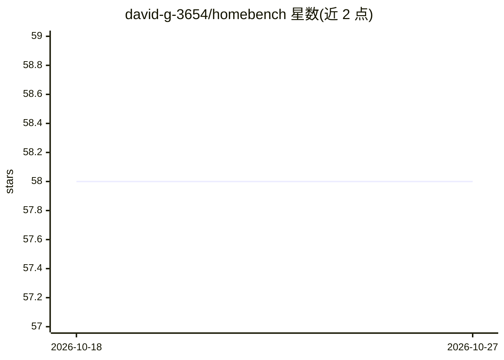

# david-g-3654/homebench

⭐ 58 · Python · MIT · 推送 2026-08-10 · [GitHub](https://github.com/david-g-3654/homebench) · 个人维护

**单命令评测本地 LLM 的速度/内存/质量并出 TUI 排行榜**

面向本地模型用户的评测 TUI 工具：自动发现本地运行时（Ollama、LM Studio、llama.cpp、vLLM、MLX 或任意 OpenAI 兼容服务）中已装的模型，测量 tok/s、TTFT、内存占用，并运行 31 个确定性评分任务（数学/推理/事实/指令遵循/抽取/代码），可选 LLM-as-judge 评分开放式任务。支持历史记录与 diff（可设 CI 回归门槛）、HTML 报告导出、批量吞吐测试及 `fit` 硬件适配检查（内置约 50 个模型目录或从 HuggingFace 在线拉取）。作者自述定位为快速首查而非严格基准：质量套件小且仅英文，速度受机器状态影响，内存为尽力测量。pip 安装，需 Python 3.9+，无需 API key。

## 筛选速览

| 维度 | 判定 | 备注 |
|---|---|---|
| AI 角色 | `ai-ecosystem` | LLM/agent 周边工具 |
| 许可风险 | `permissive` | MIT |
| 部署形态 | `library` | 以包/库形式分发 |
| 模型依赖 | local-ok | 支持本地模型 |
| 硬件要求 | — | 无带数字的原话,不猜 |
| 安装摩擦 | `low` | 无编译、无系统依赖或容器化 |
| 成熟度 | — | 结构信号不足 |

## 能力要点

- 测量 tok/s、TTFT、内存占用与 31 个确定性评分任务
- 自动发现 Ollama/LM Studio/llama.cpp/vLLM/MLX/OpenAI 兼容后端的模型
- run 历史与 diff，可 --fail-on-regression 作 CI 回归门槛
- homebench fit 按本机 RAM/VRAM 检查约 50 个模型是否放得下及量化选择

## 适用场景

- 比较本机多个本地模型哪个质量与速度合适
- 改动配置或量化后 diff 验证是否退步并接入 CI
- 导出可分享的 HTML 评测报告
- 按自己机器内存判断能运行哪些模型及量化档位

## 场景标签

`模型评测` · 领域:评测与运维

## 证据(README 行号)

> L12: `homebench` is a single-command TUI that discovers the models installed in your local runner (**Ollama**, **LM Stud
> L37: |**Quality**|31 deterministically-graded tasks across math, reasoning, factual recall, instruction-following/struct

## 星数曲线

2026-10-18 58 → 2026-10-27 58（+0）

---
*卡片 v1 · prompt 1.4 · 生成 2026-10-24 · 置信度 high · 依据 README sha `968942e44c7a` · [字段定义](../../DATASET.md)*
