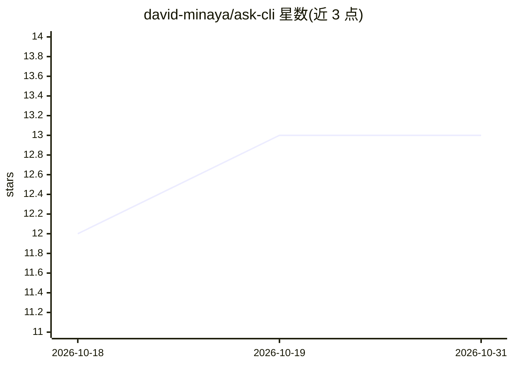

# david-minaya/ask-cli

⭐ 13 · TypeScript · MIT · 推送 2026-07-12 · [GitHub](https://github.com/david-minaya/ask-cli) · 个人维护

**终端里直接提问获取简短 AI 回答的 Node CLI**

基于 Node 的命令行 AI 问答工具：用户在终端用 ask/how/what 命令提问，获得简短直接的回答，用于命令用法、编码、报错分析等场景。默认不能执行命令或访问文件，需用 -c/--command 选项显式授权以将命令输出纳入提问上下文。内置 Gemini、OpenAI、Anthropic 模型列表，可通过 ask /connect 接入 OpenAI 兼容 API（如 llama.cpp、Ollama）。首次选择模型时提示设置对应提供商的 API key。

## 筛选速览

| 维度 | 判定 | 备注 |
|---|---|---|
| AI 角色 | `ai-native` | 本体是模型或模型工具 |
| 许可风险 | `permissive` | MIT |
| 部署形态 | `library` | 以包/库形式分发 |
| 模型依赖 | local-ok | 支持本地模型 |
| 硬件要求 | — | 无带数字的原话,不猜 |
| 安装摩擦 | `low` | 无编译、无系统依赖或容器化 |
| 成熟度 | — | 结构信号不足 |

## 能力要点

- ask/how/what 命令在终端直接提问
- 默认无命令执行与文件访问权限，-c 选项显式纳入命令输出
- 内置 Gemini/OpenAI/Anthropic 多模型可选
- ask /connect 支持 OpenAI 兼容 API 接入本地或外部提供商

## 适用场景

- 在终端快速查询命令用法或修报错
- 不想切换应用时直接问终端获取简短答案
- 接入本地 Ollama 等模型回答问题

## 场景标签

`AI 助手` · 领域:对话与助手

## 证据(README 行号)

> L5: A simple, fast, and secure tool to run AI from the terminal.
> L122: You can use the **`ask /connect`** command to connect to local models or external providers, using an **OpenAI-com

## 星数曲线

2026-10-18 12 → 2026-10-31 13（+1）

---
*卡片 v1 · prompt 1.4 · 生成 2026-10-31 · 置信度 high · 依据 README sha `58338c8b424c` · [字段定义](../../DATASET.md)*
