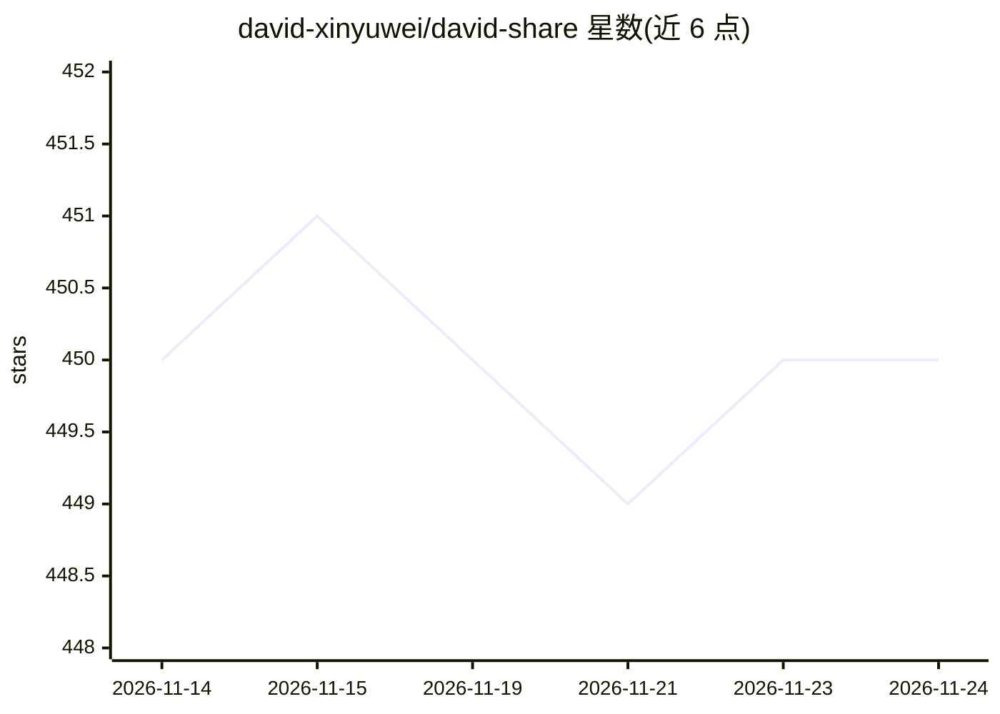

# david-xinyuwei/david-share

⭐ 450 · Jupyter Notebook · MIT · 推送 2026-11-23 · [GitHub](https://github.com/david-xinyuwei/david-share) · 个人维护 · 中文 README

**个人 AI Agents 与深度学习实战项目集合：代码、基准与讲解**

Microsoft 系统工程师魏新宇的个人仓库，汇集 AI Agent 与深度学习两大方向的动手项目：在 Microsoft Foundry/Azure 上构建、托管与运行 agent（语音、检索、MCP），以及微调、推理优化（vLLM/SGLang/投机解码）、精度与量化（FP8/FP4）、NVIDIA/AMD GPU 基准和多模态模型评测。每文件夹为独立项目，附脚本与原始结果；含两本书的配套代码。仓库超 3 GB，可用 sparse-checkout 只取单个项目。

## 筛选速览

| 维度 | 判定 | 备注 |
|---|---|---|
| AI 角色 | `ai-knowledge` | 知识聚合/清单类 |
| 许可风险 | `permissive` | MIT |
| 部署形态 | `None` |  |
| 模型依赖 | locked-api |  |
| 硬件要求 | — | 无带数字的原话,不猜 |
| 安装摩擦 | `medium` | 含编译或系统依赖之一 |
| 成熟度 | — | 结构信号不足 |

## 能力要点

- 覆盖 agent 构建与部署、微调、推理优化、量化、GPU 基准等多主题
- 每个项目自带 README、脚本、原始结果与 CI 检查
- 支持 git sparse-checkout 按需下载单个项目文件夹
- 两本出版书籍的配套代码示例

## 适用场景

- 查找 Azure/Microsoft Foundry 上部署 agent 的参考实现
- 获取 vLLM、FP8/FP4 量化、GPU 选型等推理优化的实测数据
- 按主题浏览可复现的深度学习实验项目

## 场景标签

`微调` `推理引擎` `模型量化` `多模态` · 领域:感知与多模态

## 证据(README 行号)

> L7: **Hands-on projects on building AI agents and on training, serving and measuring the models behind them, mostly on A
> L16: Each folder is a self-contained project with its own README. Many recent projects also include the scripts, raw res

## 星数曲线

2026-11-14 450 → 2026-11-24 450（+0）

---
*卡片 v1 · prompt 1.4 · 生成 2026-11-17 · 置信度 high · 依据 README sha `2fcaa4f3b5d7` · [字段定义](../../DATASET.md)*
